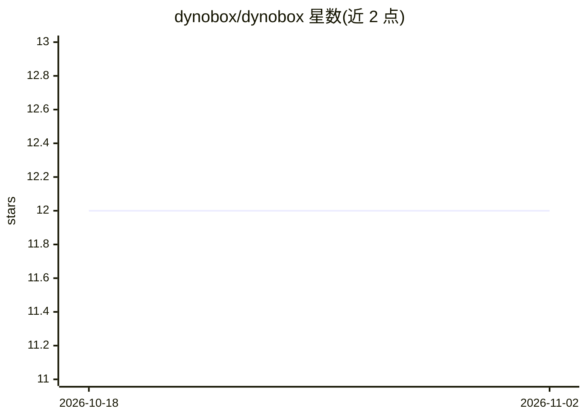

# dynobox/dynobox

⭐ 12 · TypeScript · Apache-2.0 · 推送 2026-11-01 · [GitHub](https://github.com/dynobox/dynobox) · [官网](https://dynobox.xyz) · 组织维护

**跨 harness 的编码 agent 与技能测试运行器**

开源测试运行器（CLI + SDK），用于验证编码 agent 与 agent 技能：在全新临时工作目录中运行真实工作流，捕获工具调用、shell 命令、文件变更、HTTP 请求与最终回答等证据，并用显式断言（不依赖模型评判）判定结果。支持在 Claude Code、Codex、OpenCode、Pi、Cursor CLI、Google Antigravity CLI 六种 harness 上运行同一场景并对比行为差异，可重复迭代测得通过率以暴露不稳定行为。需要 Node.js 22+ 且至少安装一个受支持 harness；本地运行无需账号，可选用 --save-run 上传运行摘要。自述为 early-access 软件，1.0 前 CLI/SDK/报告格式可能变化。

## 筛选速览

| 维度 | 判定 | 备注 |
|---|---|---|
| AI 角色 | `ai-ecosystem` | LLM/agent 周边工具 |
| 许可风险 | `permissive` | Apache-2.0 |
| 部署形态 | `library` | 以包/库形式分发 |
| 模型依赖 | — | README 未给出锁定关系 |
| 硬件要求 | — | 无带数字的原话,不猜 |
| 安装摩擦 | `low` | 无编译、无系统依赖或容器化 |
| 成熟度 | `idea` | |

## 能力要点

- 对工具调用、命令、文件、HTTP 请求、transcript 的显式断言，无需模型评判
- 同一场景可跨 6 种 harness（Claude Code/Codex/OpenCode/Pi/Cursor/Antigravity）运行对比
- 重复迭代生成通过率行（如 .FF..）以暴露 flaky 行为，保留失败证据
- 实验性 CLI mock：用静态/顺序/handler 响应替换可执行调用

## 适用场景

- 验证我写的 agent 技能在不同编码 agent 环境下行为是否一致
- 为 agent 工作流写回归测试，断言其调用了正确的工具和命令
- 重复运行场景测得通过率，定位 agent 行为的不稳定问题

## 场景标签

`模型评测` · 领域:评测与运维

## 证据(README 行号)

> L12: Open-source test runner for coding agents and skills: run real workflows,
> L26: - Run the same scenario through Claude Code, OpenAI Codex, OpenCode, Pi, Cursor
> L155: Dynobox is closer to unit testing than model-graded evals. It evaluates captured

## 星数曲线

2026-10-18 12 → 2026-11-02 12（+0）

---
*卡片 v1 · prompt 1.4 · 生成 2026-11-01 · 置信度 high · 依据 README sha `54e1b6881a4c` · [字段定义](../../DATASET.md)*
