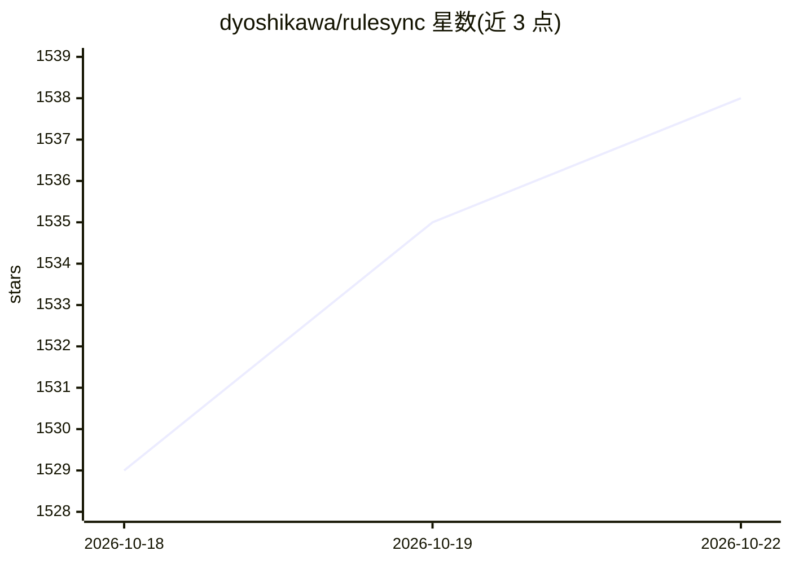

# dyoshikawa/rulesync

⭐ 1,544 · TypeScript · MIT · 推送 2026-10-22 · [GitHub](https://github.com/dyoshikawa/rulesync) · [官网](http://rulesync.dyoshikawa.com/) · 个人维护

**从统一 AI 规则文件生成多种 AI 编码工具配置的 CLI**

Node.js 命令行工具：以 .rulesync/ 目录下的统一规则文件为单一事实源，为 50 余种 AI 编码工具（Claude Code、Cursor、GitHub Copilot、Codex CLI、Kiro、OpenCode 等）及 AGENTS.md 等开放标准生成 rules、commands、MCP、permissions、subagents、skills、hooks 等配置文件。支持从既有配置导入（import）、跨工具直接转换（convert，不落地中间文件）与选择性生成。安装途径为 npm、Homebrew tap 与单二进制脚本。ignore 特性已声明弃用，由 permissions 取代；部分目标工具（如 Continue、Roo Code）按冻结兼容方式维护。

## 筛选速览

| 维度 | 判定 | 备注 |
|---|---|---|
| AI 角色 | `ai-ecosystem` | LLM/agent 周边工具 |
| 许可风险 | `permissive` | MIT |
| 部署形态 | `library` | 以包/库形式分发 |
| 模型依赖 | — | README 未给出锁定关系 |
| 硬件要求 | — | 无带数字的原话,不猜 |
| 安装摩擦 | `low` | 无编译、无系统依赖或容器化 |
| 成熟度 | — | 结构信号不足 |

## 能力要点

- 统一规则文件生成 50+ AI 编码工具的配置
- import 导入既有配置、convert 跨工具直接转换
- 覆盖 rules/MCP/permissions/subagents/skills/hooks 等特性维度
- 兼容 AGENTS.md、AgentsSkills 等开放标准

## 适用场景

- 在多个 AI 编码工具间复用同一套规则与命令配置
- 把 Cursor 规则一次性转换到 Copilot 和 Claude Code
- 从已有 CLAUDE.md / .cursorrules 迁移到统一管理工作流

## 场景标签

`提示工程` · 领域:Agent 开发

## 证据(README 行号)

> L14: A Node.js CLI tool that automatically generates configuration files for various AI development tools from unified A
> L78: ### AI Coding Tools

## 星数曲线

2026-10-18 1,529 → 2026-10-22 1,538（+9）

---
*卡片 v1 · prompt 1.4 · 生成 2026-10-21 · 置信度 high · 依据 README sha `c42b02e3b60d` · [字段定义](../../DATASET.md)*
