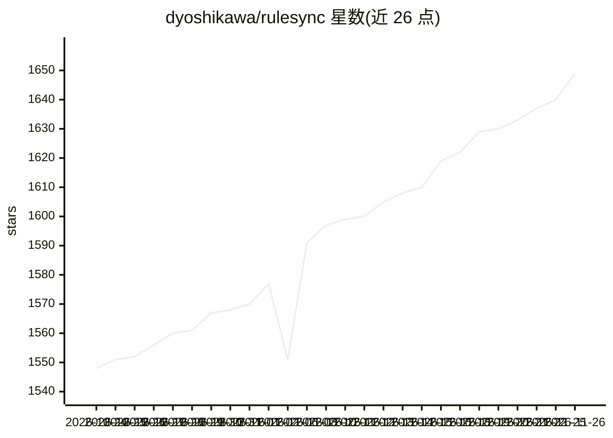

# dyoshikawa/rulesync

⭐ 1,649 · TypeScript · MIT · 推送 2026-11-25 · [GitHub](https://github.com/dyoshikawa/rulesync) · [官网](http://rulesync.dyoshikawa.com/) · 个人维护

**为 AI 编码工具统一生成/导入配置文件的 CLI**

Node.js 命令行工具：从统一的 .rulesync 规则源自动生成各类 AI 编码工具（rules、commands、MCP、ignore、subagents、skills 等）的配置文件，支持选择性生成、从现有配置（CLAUDE.md、.cursorrules 等）导入，以及不经中间目录的工具间直接转换。通过 npm、Homebrew tap 或单二进制脚本安装，面向同时使用多个 AI 编码工具、需要同步规则配置的开发者。

## 筛选速览

| 维度 | 判定 | 备注 |
|---|---|---|
| AI 角色 | `ai-ecosystem` | LLM/agent 周边工具 |
| 许可风险 | `permissive` | MIT |
| 部署形态 | `library` | 以包/库形式分发 |
| 模型依赖 | — | README 未给出锁定关系 |
| 硬件要求 | — | 无带数字的原话,不猜 |
| 安装摩擦 | `low` | 无编译、无系统依赖或容器化 |
| 成熟度 | — | 结构信号不足 |

## 能力要点

- 从统一规则源生成 60+ AI 编码工具的配置文件
- 支持 rules/ignore/mcp/commands/subagents/skills/hooks/permissions 等特性维度
- import 命令从现有配置（CLAUDE.md、.cursorrules 等）导入
- convert 命令支持工具间配置直接转换

## 适用场景

- 团队在多种 AI 编码工具间共享同一份规则配置
- 把已有 Cursor 规则一次性转换成 Claude Code / Copilot 配置
- 用 .rulesync/ 作为单一配置源避免手动维护多份规则文件

## 场景标签

 · 领域:开发工具/配置管理

## 证据(README 行号)

> L14: A Node.js CLI tool that automatically generates configuration files for various AI development tools from unified A
> L74: ## Supported Tools and Features
> L76: The tables below show whether each tool supports a given feature (✅ = supported, blank = not supported). A ✅ means 

## 星数曲线

2026-10-24 1,548 → 2026-11-26 1,649（+101）

---
*卡片 v1 · prompt 1.4 · 生成 2026-11-26 · 置信度 mid · 依据 README sha `2bc385f2ef02` · [字段定义](../../DATASET.md)*
