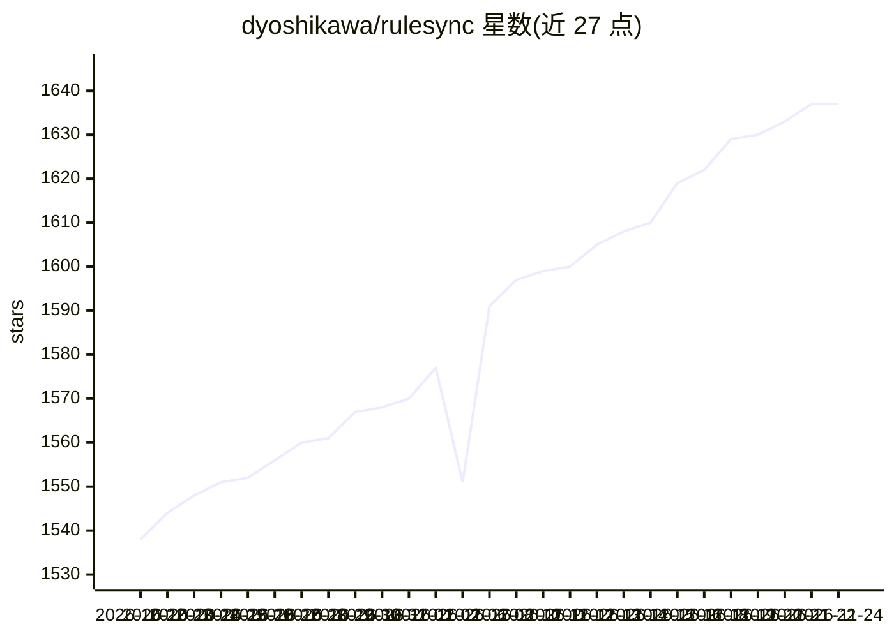

# dyoshikawa/rulesync

⭐ 1,637 · TypeScript · MIT · 推送 2026-11-22 · [GitHub](https://github.com/dyoshikawa/rulesync) · [官网](http://rulesync.dyoshikawa.com/) · 个人维护

**为开发者统一生成多种 AI 编码工具配置文件的 CLI**

Node.js CLI 工具，从统一的 AI 规则文件自动生成各 AI 开发工具的配置文件，覆盖 rules、ignore、MCP、commands、subagents、skills、hooks、permissions 等特性。支持从 CLAUDE.md、.cursorrules 等既有配置导入到 .rulesync 目录，也提供 convert 子命令在不同工具间直接转换配置而无需落地中间文件。支持约 60 个工具目标及 AGENTS.md 等开放标准，README 中逐工具列出特性支持矩阵并对多个目标给出弃用/维护状态说明。安装方式包括 npm、Homebrew tap 与单二进制脚本。

## 筛选速览

| 维度 | 判定 | 备注 |
|---|---|---|
| AI 角色 | `ai-ecosystem` | LLM/agent 周边工具 |
| 许可风险 | `permissive` | MIT |
| 部署形态 | `library` | 以包/库形式分发 |
| 模型依赖 | — | README 未给出锁定关系 |
| 硬件要求 | — | 无带数字的原话,不猜 |
| 安装摩擦 | `low` | 无编译、无系统依赖或容器化 |
| 成熟度 | — | 结构信号不足 |

## 能力要点

- 从统一规则文件生成多工具配置，支持 rules/MCP/commands/subagents/skills/hooks/permissions
- rulesync import 从既有配置导入，convert 子命令直接跨工具转换
- 支持约 60 个 AI 编码工具及 AGENTS.md 开放标准
- npm、Homebrew tap、单二进制脚本三种安装途径

## 适用场景

- 团队同时使用多种 AI 编码工具时统一维护一份规则源
- 从 Cursor 规则一键转换出 Copilot 与 Claude Code 配置
- 将现有 CLAUDE.md/.cursorrules 导入为可管理的统一格式

## 场景标签

 · 领域:开发者工具/AI 编码工具配置管理

## 证据(README 行号)

> L14: A Node.js CLI tool that automatically generates configuration files for various AI development tools from unified A
> L76: The tables below show whether each tool supports a given feature (✅ = supported, blank = not supported). A ✅ means 

## 星数曲线

2026-10-22 1,538 → 2026-11-24 1,637（+99）

---
*卡片 v1 · prompt 1.4 · 生成 2026-11-23 · 置信度 mid · 依据 README sha `07717e0059b7` · [字段定义](../../DATASET.md)*
