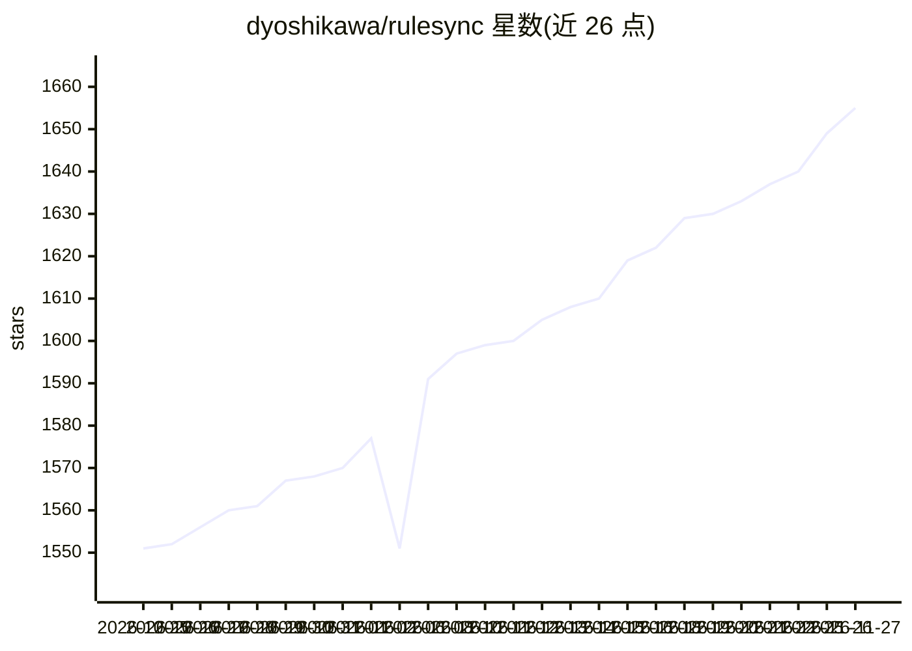

# dyoshikawa/rulesync

⭐ 1,655 · TypeScript · MIT · 推送 2026-11-26 · [GitHub](https://github.com/dyoshikawa/rulesync) · [官网](http://rulesync.dyoshikawa.com/) · 个人维护

**为多种 AI 编码工具统一生成配置文件的 CLI**

Node.js CLI 工具，从统一的 .rulesync 规则文件为多种 AI 开发工具自动生成配置文件，覆盖 rules、ignore、MCP、commands、subagents、skills、hooks、permissions 等特性。支持从既有配置（CLAUDE.md、.cursorrules 等）导入，可用 convert 命令在工具间直接转换配置而不落盘中间文件。通过 npm、Homebrew tap 或单文件脚本安装，附带 init 脚手架命令与支持工具特性矩阵文档。

## 筛选速览

| 维度 | 判定 | 备注 |
|---|---|---|
| AI 角色 | `ai-ecosystem` | LLM/agent 周边工具 |
| 许可风险 | `permissive` | MIT |
| 部署形态 | `library` | 以包/库形式分发 |
| 模型依赖 | — | README 未给出锁定关系 |
| 硬件要求 | — | 无带数字的原话,不猜 |
| 安装摩擦 | `low` | 无编译、无系统依赖或容器化 |
| 成熟度 | — | 结构信号不足 |

## 能力要点

- 从统一 .rulesync 源文件为数十种 AI 编码工具生成配置
- 支持导入既有配置与 convert 一键跨工具转换
- 覆盖 rules/MCP/commands/subagents/skills/hooks/permissions 等特性
- 提供 init 脚手架与支持工具特性矩阵

## 适用场景

- 团队在多种 AI 编码工具间维护同一套规则
- 把 Cursor 规则批量转换为 Copilot 与 Claude Code 配置
- 将已有工具配置导入 .rulesync 统一管理

## 场景标签

 · 领域:开发者工具/AI 编码配置同步

## 证据(README 行号)

> L14: A Node.js CLI tool that automatically generates configuration files for various AI development tools from unified A
> L76: The tables below show whether each tool supports a given feature (✅ = supported, blank = not supported). A ✅ means 

## 星数曲线

2026-10-25 1,551 → 2026-11-27 1,655（+104）

---
*卡片 v1 · prompt 1.4 · 生成 2026-11-27 · 置信度 mid · 依据 README sha `9cc6b1844915` · [字段定义](../../DATASET.md)*
