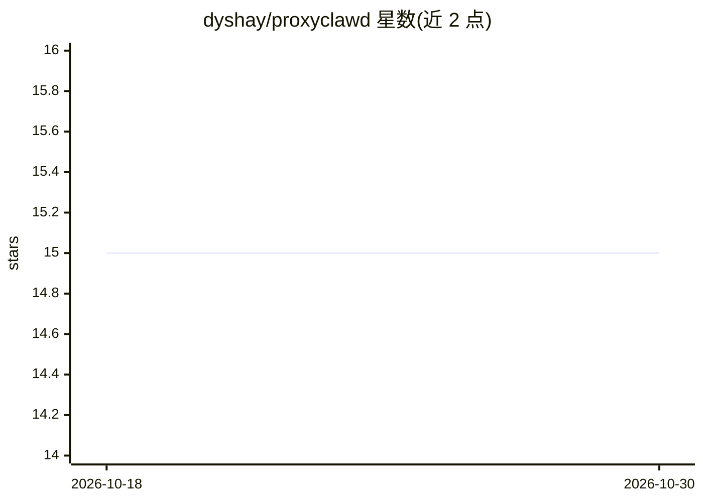

# dyshay/proxyclawd

⭐ 15 · Rust · 推送 2026-03-08 · [GitHub](https://github.com/dyshay/proxyclawd) · 个人维护

**面向 Claude Code 的 MITM 代理：拦截、检视并发送 Anthropic API 请求**

用 Rust 编写的 HTTPS MITM 代理，通过 CONNECT 隧道与运行时 TLS 证书生成拦截 Claude Code 到 Anthropic API 的流量，解析 SSE 流并提供三面板 TUI 与基于 WebSocket 的 Web UI 实时查看；支持从 UI 直接编写并发送消息（经 claude -p 子进程自动走代理）、--headless 无界面模式用于自动化，并附带独立 MCP 服务器与 OpenClaw 技能脚本向任意 MCP 客户端暴露代理数据。提供 Linux/macOS/Windows 预编译二进制，也可 cargo 源码构建；使用前需安装生成的 CA 证书并设置 HTTPS_PROXY。

## 筛选速览

| 维度 | 判定 | 备注 |
|---|---|---|
| AI 角色 | `ai-ecosystem` | LLM/agent 周边工具 |
| 许可风险 | `none` | — |
| 部署形态 | `library` | 以包/库形式分发 |
| 模型依赖 | — | README 未给出锁定关系 |
| 硬件要求 | — | 无带数字的原话,不猜 |
| 安装摩擦 | `medium` | 含编译或系统依赖之一 |
| 成熟度 | — | 结构信号不足 |

## 能力要点

- HTTPS MITM（CONNECT 隧道 + 运行时 TLS 证书生成）与 SSE 流解析转发
- TUI / Web UI / headless 三种运行形态
- 从 UI 发送消息：spawn claude -p 子进程自动经代理路由
- 独立 MCP 服务器（proxyclawd-mcp）暴露查询与发送工具

## 适用场景

- 实时查看 Claude Code 的 API 请求与流式响应
- 在服务器/CI 中以 headless 模式自动化拦截与发消息
- 让 Claude Code、Cursor 等 MCP 客户端查询被拦截的请求

## 场景标签

`LLM 可观测性` · 领域:评测与运维

## 证据(README 行号)

> L3: MITM proxy for Claude Code with real-time TUI & web UI — intercept, inspect, and **send your own messages** via Clau
> L12: - **MCP server** (`proxyclawd-mcp`): expose proxy data to any MCP client (Claude Code, Cursor, etc.)
> L162: `proxyclawd-mcp` is a standalone MCP (Model Context Protocol) server that connects to the ProxyClawd web API. It l

## 星数曲线

2026-10-18 15 → 2026-10-30 15（+0）

---
*卡片 v1 · prompt 1.4 · 生成 2026-10-30 · 置信度 mid · 依据 README sha `07a8cebca42b` · [字段定义](../../DATASET.md)*
