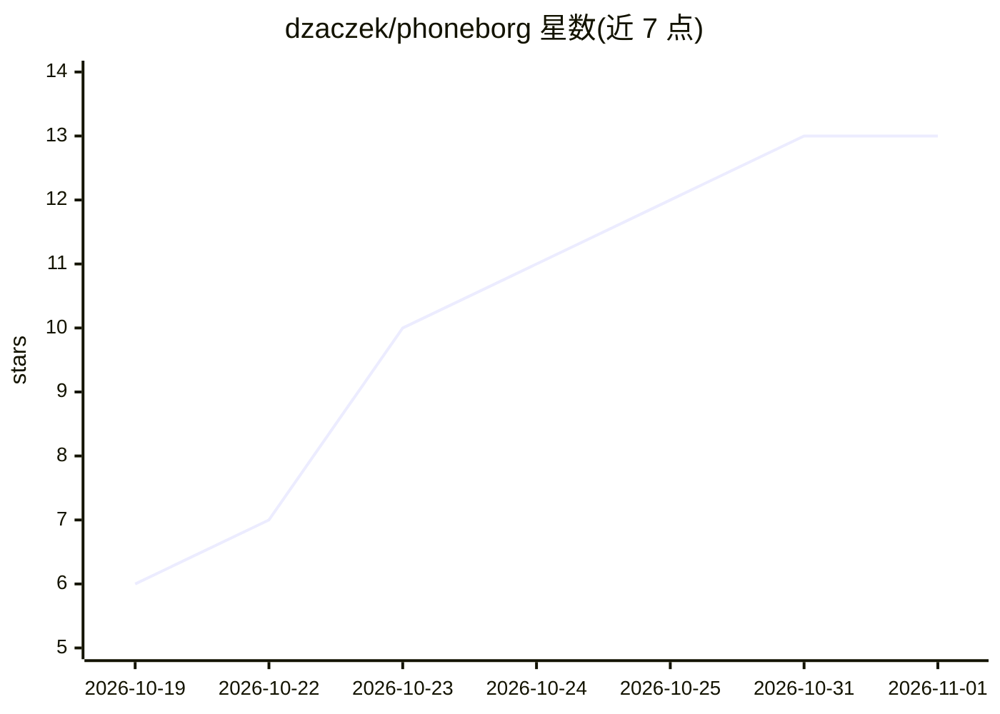

# dzaczek/phoneborg

⭐ 13 · Go · Apache-2.0 · 推送 2026-10-20 · [GitHub](https://github.com/dzaczek/phoneborg) · 个人维护

**把旧 Android 手机组成 LLM 推理集群的 PoC 控制器与网关**

面向开发者/极客的概念验证项目：通过 ADB 零接触方式在每台 Android 手机上部署节点代理，手机自动跑分、加入集群并用 llama.cpp 服务 GGUF 模型；对外暴露单一 OpenAI 兼容端点（兼支持 Ollama API）。控制器负责模型放置、请求路由、会话亲和、故障转移，并导出 Prometheus 指标与 Grafana 面板。提供单手机、语义路由、并行池、Super Borg 编排、Big Brain 跨机分层等多种集群模式。自我声明为 proof of concept，v0 部分接口无鉴权，API 会变更。提供 install.sh 一键安装（host 或 docker compose）。

## 筛选速览

| 维度 | 判定 | 备注 |
|---|---|---|
| AI 角色 | `ai-ecosystem` | LLM/agent 周边工具 |
| 许可风险 | `permissive` | Apache-2.0 |
| 部署形态 | `self-host` | docker 或自建部署 |
| 模型依赖 | local-ok | 支持本地模型 |
| 硬件要求 | — | 无带数字的原话,不猜 |
| 安装摩擦 | `low` | 无编译、无系统依赖或容器化 |
| 成熟度 | `idea` | |

## 能力要点

- ADB 零接触供给：插上 USB 即自动注册、跑分并进入 ACTIVE
- OpenAI 兼容网关：流式、会话亲和、故障转移、避开高温慢机
- Big Brain 模式经 llama.cpp RPC 把超出单机 RAM 的大模型分层到多台手机
- Prometheus 指标与 Grafana 面板、pbctl CLI 与 Web 管理面板

## 适用场景

- 把闲置旧手机拼成家里可用的 LLM 推理服务
- 通过一个 OpenAI 兼容端点统一调用多台手机上的模型
- 在真实硬件上实验多机协同推理（池、编排、跨机分层）

## 场景标签

`推理引擎` · 领域:训练与推理

## 证据(README 行号)

> L21: llama.cpp. Clients talk to **one
> L22: OpenAI-compatible endpoint**. The controller decides which phone serves which

## 星数曲线

2026-10-19 6 → 2026-11-01 13（+7）

---
*卡片 v1 · prompt 1.4 · 生成 2026-10-31 · 置信度 high · 依据 README sha `f55d356a5e08` · [字段定义](../../DATASET.md)*
