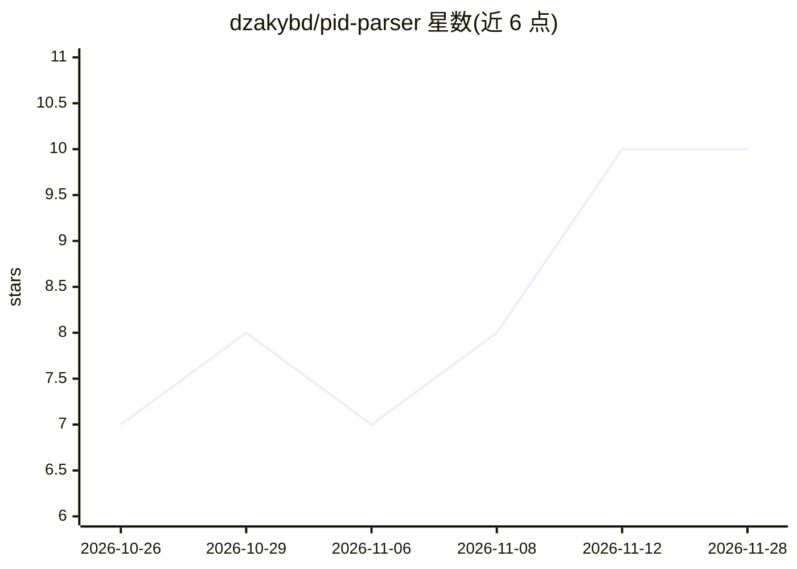

# dzakybd/pid-parser

⭐ 10 · Python · MIT · 推送 2026-10-15 · [GitHub](https://github.com/dzakybd/pid-parser) · [官网](https://dzaky.ai.id/en/blog/pid-parser-pid-to-graph) · 个人维护

**把 P&ID 工程图转为可查询 SQL/图数据的解析工具**

面向工程师与 AI agent，将 P&ID 管道仪表流程图转换为结构化数据：视觉模型分块识别符号，传统计算机视觉（阈值化与连通域标记）提取管线连接，无需 GPU 或训练。输出 graph.json，并导出 CSV、SQL、GraphML、Cypher，可载入电子表格、SQLite/PostgreSQL 或 Neo4j。提供两个版本：供 Claude Code/Codex 等 harness 加载的 agent skill（npx 安装），以及基于 LangChain Deep Agents 的运行器（ChatGPT 登录）。作者声明仅在一张密集图纸上完成转换测试，无虚线信号边提取。

## 筛选速览

| 维度 | 判定 | 备注 |
|---|---|---|
| AI 角色 | `ai-native` | 本体是模型或模型工具 |
| 许可风险 | `permissive` | MIT |
| 部署形态 | `library` | 以包/库形式分发 |
| 模型依赖 | — | README 未给出锁定关系 |
| 硬件要求 | — | 无带数字的原话,不猜 |
| 安装摩擦 | `low` | 无编译、无系统依赖或容器化 |
| 成熟度 | — | 结构信号不足 |

## 能力要点

- 视觉模型分块识别符号 + 传统 CV 提取连接，无需 GPU 或训练
- 导出 CSV、SQL、GraphML、Cypher，支持电子表格/RDBMS/Neo4j
- 提供 agent skill 与 LangChain Deep Agents 两种运行方式
- 带 eval/ 评分脚本，基于 PID2Graph ground truth 计算 P/R/F1

## 适用场景

- 查询图纸内容（如某泵与某罐之间有哪些阀门）
- 统计并列出图纸中的组件、检查阀门隔离范围
- 把图纸数据导入 SQL、电子表格或 Neo4j
- 给 AI 助手提供图结构数据而非图片

## 场景标签

`知识图谱` `文档解析` · 领域:知识与检索

## 证据(README 行号)

> L3: Turn a P&ID drawing into data you can ask: SQL tables and a graph that people and AI agents can query. A vision mode
> L7: 1. **A skill for coding agents** (Claude Code, Codex and others): `npx skills add dzakybd/pid-parser`
> L8: 2. **A LangChain Deep Agents version** you can run in your own agent workflow (`agent/run.py`)

## 星数曲线

2026-10-26 7 → 2026-11-28 10（+3）

---
*卡片 v1 · prompt 1.4 · 生成 2026-11-19 · 置信度 high · 依据 README sha `99761fafaab6` · [字段定义](../../DATASET.md)*
