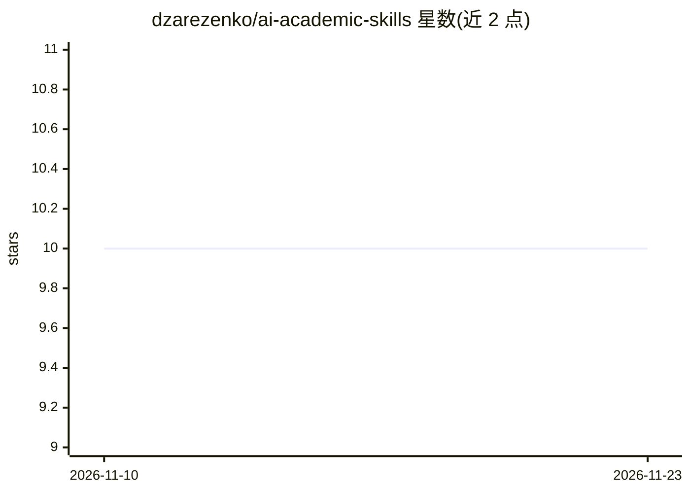

# dzarezenko/ai-academic-skills

⭐ 10 · Python · MIT · 推送 2026-03-11 · [GitHub](https://github.com/dzarezenko/ai-academic-skills) · 个人维护 · 中文 README

**给研究者/学生提供的学术研究与写作 AI 技能集**

面向研究者、学生和学术写作者的模块化 AI 技能集，覆盖引用规范化（如转为乌克兰 DSTU 8302:2015 标准）、摘要生成与改写、查重风险模式检查、文献综述（论文筛选、相关工作综合）、实验文档（数据集卡、评估报告）等任务。每个技能自包含、可独立使用，全部提供乌克兰语和英语两个语言版本，并通过共享目录提供模板、示例与 JSON/YAML 输入输出 schema。以 MIT 许可开源，README 未给出安装与运行命令。

## 筛选速览

| 维度 | 判定 | 备注 |
|---|---|---|
| AI 角色 | `ai-knowledge` | 知识聚合/清单类 |
| 许可风险 | `permissive` | MIT |
| 部署形态 | `None` |  |
| 模型依赖 | — | README 未给出锁定关系 |
| 硬件要求 | — | 无带数字的原话,不猜 |
| 安装摩擦 | `low` | 无编译、无系统依赖或容器化 |
| 成熟度 | — | 结构信号不足 |

## 能力要点

- 技能按引用、写作、文献综述、实验四类组织，自包含可独立使用
- 每个技能均提供乌克兰语/英语双语版本
- 共享目录含模板、示例与 JSON/YAML schema
- 含 DSTU 8302:2015 乌克兰学术引用标准转换技能

## 适用场景

- 将参考文献转换为乌克兰学术标准的引用格式
- 生成或润色乌克兰语/英语结构化摘要
- 快速评估论文相关性并综合相关工作章节
- 为实验产出数据集文档卡与评估报告

## 场景标签

`科研工具` · 领域:学习与行业

## 证据(README 行号)

> L3: A modular collection of AI-powered academic skills for research workflows, citation normalization, scientific writin
> L7: **ai-academic-skills** aims to provide researchers, students, and academic writers with a structured, reusable toolk
> L10: - **Modularity** — each skill is self-contained and independently usable.

## 星数曲线

2026-11-10 10 → 2026-11-23 10（+0）

---
*卡片 v1 · prompt 1.4 · 生成 2026-11-19 · 置信度 high · 依据 README sha `66e18eeac6ba` · [字段定义](../../DATASET.md)*
