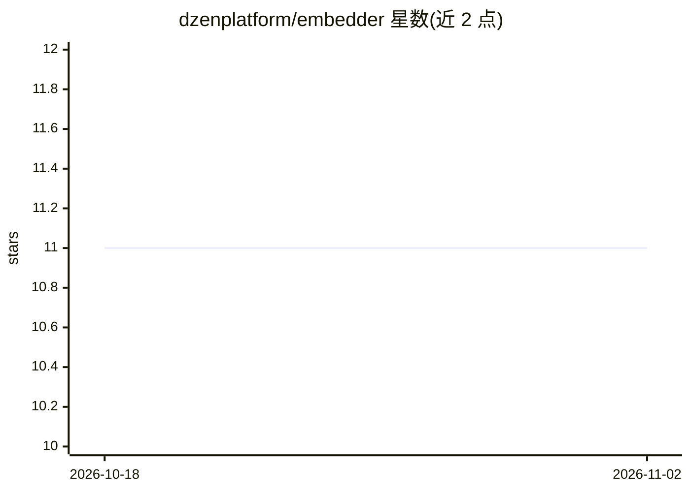

# dzenplatform/embedder

⭐ 11 · Python · BSD-3-Clause · 推送 2026-10-21 · [GitHub](https://github.com/dzenplatform/embedder) · 个人维护

**自托管嵌入服务：OpenAI 兼容 API，供 Dzen Chat RAG 使用**

面向 Dzen Chat 的单进程嵌入服务：加载一个 SentenceTransformer 模型（默认 deepvk/USER-bge-m3），暴露 OpenAI 兼容的 POST /v1/embeddings 端点，实时请求优先于批处理请求（X-Dzen-Embedding-Priority: batch）。支持 cpu/mps/cuda 三种设备后端，通过 make setup/run 原生运行或 Docker Compose 部署（镜像 mxen/dzen-embedder，含 CPU 与 CUDA 12.6 变体），另提供 systemd 单元与 Prometheus /metrics。限制：MPS 仅限 macOS 原生进程；Jetson 与 CUDA arm64 不在此版本内。

## 筛选速览

| 维度 | 判定 | 备注 |
|---|---|---|
| AI 角色 | `ai-ecosystem` | LLM/agent 周边工具 |
| 许可风险 | `permissive` | BSD-3-Clause |
| 部署形态 | `self-host` | docker 或自建部署 |
| 模型依赖 | — | README 未给出锁定关系 |
| 硬件要求 | — | 无带数字的原话,不猜 |
| 安装摩擦 | `low` | 无编译、无系统依赖或容器化 |
| 成熟度 | — | 结构信号不足 |

## 能力要点

- OpenAI 兼容 /v1/embeddings 端点，加载单个 SentenceTransformer 模型
- 实时请求严格优先于批处理请求的队列机制
- cpu/mps/cuda 三种设备后端，Docker 镜像分 CPU 与 CUDA 变体
- Prometheus /metrics 指标暴露与可选 dashboard

## 适用场景

- 为 RAG 流水线提供本地/自托管嵌入计算服务
- 用 OpenAI 兼容客户端直接调用自建嵌入端点
- 在 Apple Silicon（MPS）或 NVIDIA GPU 上加速嵌入推理

## 场景标签

`推理引擎` · 领域:训练与推理

## 证据(README 行号)

> L34: Standalone single-process embedding service for Dzen Chat. It loads one
> L35: SentenceTransformer model and exposes an OpenAI-compatible
> L36: `POST /v1/embeddings` endpoint. Realtime requests have strict priority over

## 星数曲线

2026-10-18 11 → 2026-11-02 11（+0）

---
*卡片 v1 · prompt 1.4 · 生成 2026-11-02 · 置信度 high · 依据 README sha `d29f812f64d3` · [字段定义](../../DATASET.md)*
