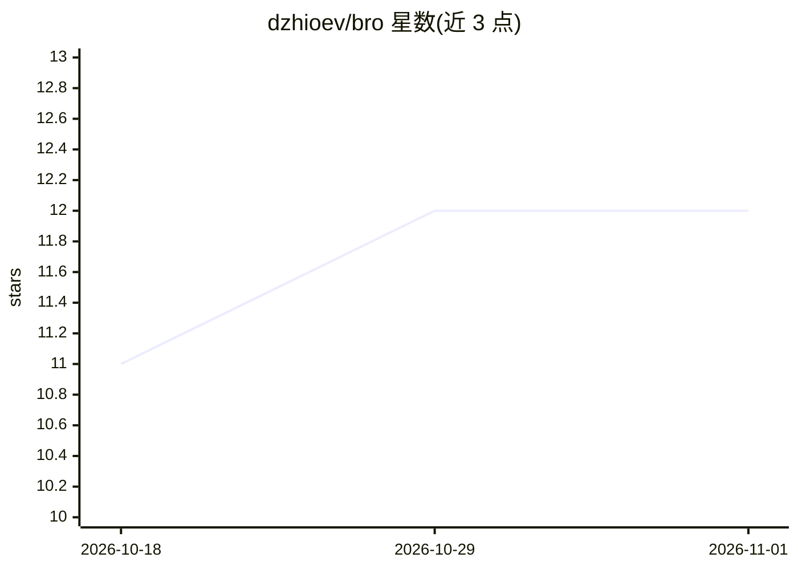

# dzhioev/bro

⭐ 12 · Python · Apache-2.0 · 推送 2026-10-31 · [GitHub](https://github.com/dzhioev/bro) · 个人维护

**面向开发者的多 AI agent 声明式框架：一处声明、沙箱运行**

Python 框架，将每个 agent（bro）的提示词、工具、密钥、流程与可召唤对象声明在一个类中，同一声明可运行于 Claude Code 会话或框架自带 agent loop，模型在启动时指定（如 openai、opus）。每次运行在新容器内进行，容器内只含声明的工具与凭据，凭据经宿主机解析后注入、容器销毁即消失。CLI 命令可从参数解析器自动生成工具，运行记录为可回溯的 trail。README 顶部声明处于早期开发阶段，接口无弃用周期地变动，按原样提供无担保。安装经 BOOTSTRAP.md 可执行清单或克隆仓库运行 setup.sh，宿主需 Git、Python 3.12+、uv、Docker 与 Claude Code。

## 筛选速览

| 维度 | 判定 | 备注 |
|---|---|---|
| AI 角色 | `ai-ecosystem` | LLM/agent 周边工具 |
| 许可风险 | `permissive` | Apache-2.0 |
| 部署形态 | `None` |  |
| 模型依赖 | locked-api |  |
| 硬件要求 | — | 无带数字的原话,不猜 |
| 安装摩擦 | `low` | 无编译、无系统依赖或容器化 |
| 成熟度 | `idea` | |

## 能力要点

- 一次声明，多 harness（Claude Code / 自带 loop）与多 LLM 运行
- 每次会话运行于新容器，凭据按声明解析注入、不列出
- CLI 命令从解析器自动生成参数化工具（无 shell 中介）
- 运行留有 trail，可用 rewind show 回看

## 适用场景

- 为项目定义职责受限的 agent（如 issue 分诊）并在沙箱中运行
- 让 agent 间以受控召唤与凭据传递方式协作
- 在不同模型与 harness 间复用同一 agent 声明

## 场景标签

`Agent 框架` `多智能体` · 领域:Agent 开发

## 证据(README 行号)

> L9: **Declare an agent once.
> L16: The same declaration runs as a Claude Code session or under bro's own agent loop, one-shot or interactive, on which
> L231: A Claude session comes with Claude's tools and skills, so the declaration withholds the ones it does not want and 

## 星数曲线

2026-10-18 11 → 2026-11-01 12（+1）

---
*卡片 v1 · prompt 1.4 · 生成 2026-11-01 · 置信度 high · 依据 README sha `9cf23558e9ba` · [字段定义](../../DATASET.md)*
