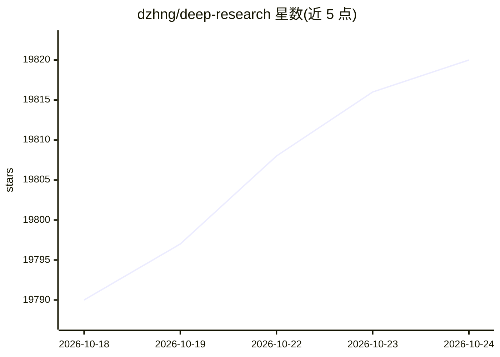

# dzhng/deep-research

⭐ 19,820 · TypeScript · MIT · 推送 2026-04-11 · [GitHub](https://github.com/dzhng/deep-research) · 个人维护

**面向研究者的极简深度研究 agent：迭代搜索生成带来源报告**

以搜索、网页抓取与 LLM 组合实现迭代式深度研究的助手：根据研究目标生成搜索查询，处理结果、递归下钻，可配置研究广度（breadth）与深度（depth），并通过追问澄清需求，最终产出含来源的 markdown 报告。代码量控制在 500 行内以便理解与二次开发。需 Node.js 环境及 Firecrawl、OpenAI 的 API key，默认用 o3-mini；支持本地 LLM、DeepSeek R1（经 Fireworks）及任意 OpenAI 兼容端点，提供 npm 与 Docker 两种运行方式。

## 筛选速览

| 维度 | 判定 | 备注 |
|---|---|---|
| AI 角色 | `ai-native` | 本体是模型或模型工具 |
| 许可风险 | `permissive` | MIT |
| 部署形态 | `self-host` | docker 或自建部署 |
| 模型依赖 | locked-api |  |
| 硬件要求 | — | 无带数字的原话,不猜 |
| 安装摩擦 | `low` | 无编译、无系统依赖或容器化 |
| 成熟度 | — | 结构信号不足 |

## 动量与使用信号

- 维护:`declining` — 距上次 push 189.4 天,年发版 0,16 位贡献者
- 涨星:近 1 天 **+0**(自 20261016 起算)
- 安装:github 包 `release-assets` 月下载无数据
- 平台:— · 协议:OPENAI-API

## 能力要点

- 迭代式深度研究：生成查询→处理结果→递归下钻
- 可配置研究广度与深度，带追问澄清机制
- 支持本地 LLM、DeepSeek R1 与 OpenAI 兼容自定义端点
- 并行并发处理多个搜索与结果分析

## 适用场景

- 对任意主题自动完成多轮搜索并汇总成报告
- 以极简代码为底座开发自己的深度研究 agent
- 配合本地模型离线运行研究流程

## 场景标签

`科研工具` · 领域:学习与行业

## 证据(README 行号)

> L3: An AI-powered research assistant that performs iterative, deep research on any topic by combining search engines, we
> L5: The goal of this repo is to provide the simplest implementation of a deep research agent - e.g. an agent that can re
> L30: - API keys for:

## 星数曲线

2026-10-18 19,790 → 2026-10-24 19,820（+30）

---
*卡片 v1 · prompt 1.4 · 生成 2026-10-18 · 置信度 high · 依据 README sha `1e06cba1da6e` · [字段定义](../../DATASET.md)*
