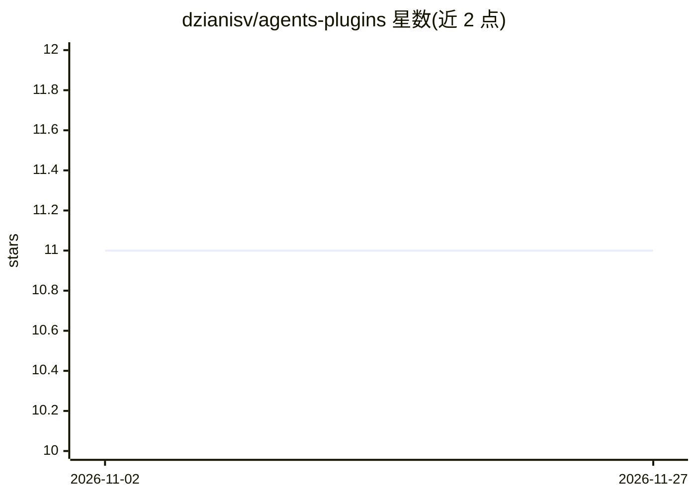

# dzianisv/agents-plugins

⭐ 11 · TypeScript · MIT · 推送 2026-11-19 · [GitHub](https://github.com/dzianisv/agents-plugins) · 个人维护

**为 OpenCode 与 Claude Code 提供停止判定与工作流门禁的插件集**

面向 AI 编码 agent 的插件仓库，核心是 Reflection-3 判定层：每轮对话结束后分类停止是否过早，并重新注入反馈让 agent 继续；同时强制工作流门禁（测试须运行通过、PR 须创建、CI 须变绿）。作者报告基于 143 个真实会话、227 次停止的测量，其中 78% 判定为过早。实现 Reflexion 模式（LLM judge + 反馈回注入，最多重试 3 次），另含会话反思、规则审计、CI 阻断、自改进复盘、TTS 与 Telegram 通知等十余个插件。已归档，功能迁移至 agents-supervisor 仓库。

## 筛选速览

| 维度 | 判定 | 备注 |
|---|---|---|
| AI 角色 | `ai-ecosystem` | LLM/agent 周边工具 |
| 许可风险 | `permissive` | MIT |
| 部署形态 | `library` | 以包/库形式分发 |
| 模型依赖 | — | README 未给出锁定关系 |
| 硬件要求 | — | 无带数字的原话,不猜 |
| 安装摩擦 | `medium` | 含编译或系统依赖之一 |
| 成熟度 | — | 结构信号不足 |

## 能力要点

- 每轮结束运行的 LLM judge，分类停止为 complete 或 premature 并重新提示
- 工作流门禁：测试通过、PR 创建、CI 绿灯作为完成条件
- 支持 OpenCode 与 Claude Code 双运行时，共 14 个插件
- 配套 Agent Skills（会话库读取、LLM-as-judge 评估等 5 项）

## 适用场景

- 阻止编码 agent 在未跑测试、未建 PR 时就提前停止
- 会话中周期性注入反思提示，检查目标与验收标准
- 推送后 CI 红灯或运行中时阻断回合结束
- 任务完成后通过 Telegram 接收通知并用语音回复

## 场景标签

`编码 Agent` · 领域:编码与开发

## 证据(README 行号)

> L10: **78% of AI coding agent stops are premature.** This is a judge layer that catches them.
> L18: `Reflection-3` fires after every agent turn, classifies the stop as complete or premature, and re-prompts with targ
> L41: - **opencode** — add `/abs/path/to/agents-plugins/packages/<name>` (the directory, not a file) to `plugins` in `~/.

## 星数曲线

2026-11-02 11 → 2026-11-27 11（+0）

---
*卡片 v1 · prompt 1.4 · 生成 2026-11-18 · 置信度 high · 依据 README sha `1ceb4306bb73` · [字段定义](../../DATASET.md)*
