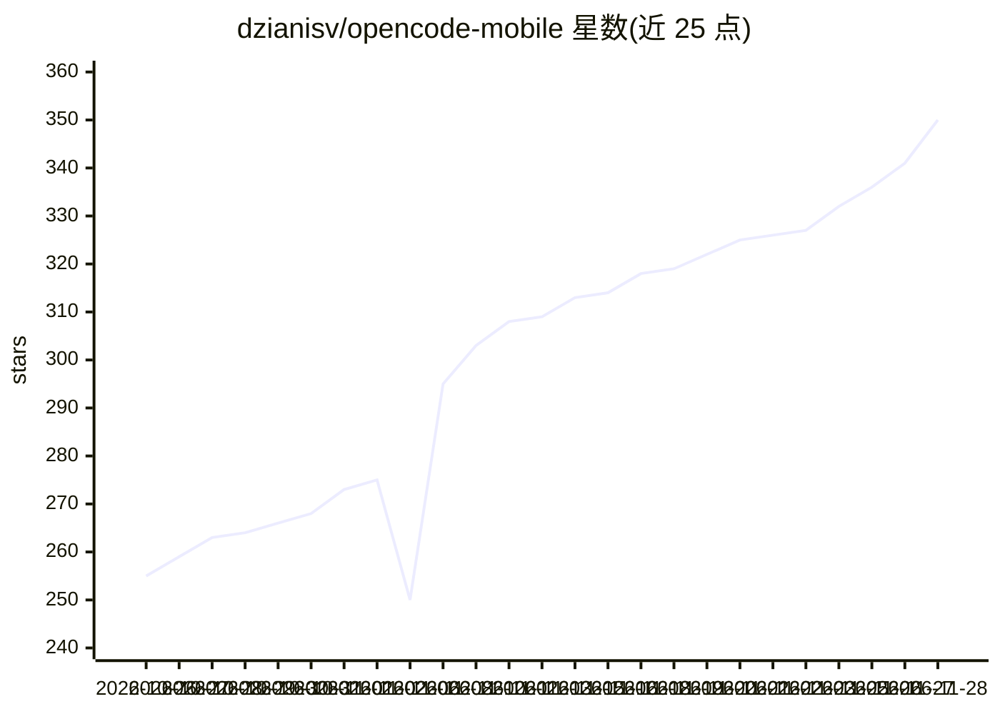

# dzianisv/opencode-mobile

⭐ 350 · TypeScript · MIT · 推送 2026-11-26 · [GitHub](https://github.com/dzianisv/opencode-mobile) · [官网](https://agentlabs.cc/opencode) · 组织维护

**Android 手机客户端：远程操作自托管 opencode 编码 agent**

面向已自托管 opencode 服务器的开发者的 Android 客户端（React Native/Expo 构建），通过 opencode 的 HTTP + SSE API 提供会话浏览、逐 token 流式聊天、文件变更 diff 查看、工具调用审批与多连接管理。本身是薄客户端，所有模型调用由服务端完成，需用户自备 API key；支持经局域网、Cloudflare Tunnel、ngrok 或 Tailscale 连接，凭据存于 Android Keystore。提供离线演示模式；无 iOS 版本。

## 筛选速览

| 维度 | 判定 | 备注 |
|---|---|---|
| AI 角色 | `ai-ecosystem` | LLM/agent 周边工具 |
| 许可风险 | `permissive` | MIT |
| 部署形态 | `library` | 以包/库形式分发 |
| 模型依赖 | — | README 未给出锁定关系 |
| 硬件要求 | — | 无带数字的原话,不猜 |
| 安装摩擦 | `low` | 无编译、无系统依赖或容器化 |
| 成熟度 | — | 结构信号不足 |

## 能力要点

- 通过 opencode HTTP+SSE API 实现流式聊天与文件变更事件订阅
- 工具调用审批与内联 diff 查看器
- 多连接管理：局域网/Cloudflare Tunnel/ngrok/Tailscale
- 凭据经 Android Keystore 存储，含生物识别解锁

## 适用场景

- 在手机上查看和推进自托管 opencode 服务器上的编码会话
- 外出时审批 agent 的工具调用并审查代码改动
- 无服务器时用离线演示了解 agent 工作流程

## 场景标签

`编码 Agent` · 领域:编码与开发

## 证据(README 行号)

> L3: **The open-source Android client for the opencode AI coding agent.**
> L94: OpenCode Mobile is a thin client. It speaks the opencode HTTP + SSE API: listing sessions, sending messages, stream

## 星数曲线

2026-10-26 255 → 2026-11-28 350（+95）

---
*卡片 v1 · prompt 1.4 · 生成 2026-11-26 · 置信度 mid · 依据 README sha `cecdb73ee3de` · [字段定义](../../DATASET.md)*
