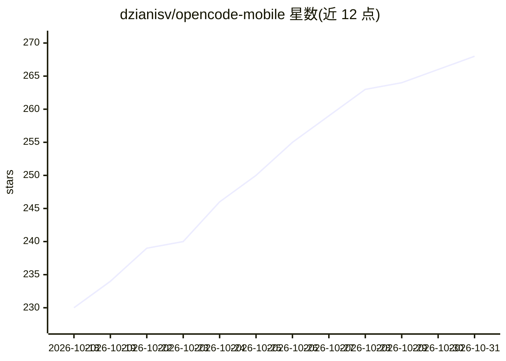

# dzianisv/opencode-mobile

⭐ 268 · TypeScript · MIT · 推送 2026-10-26 · [GitHub](https://github.com/dzianisv/opencode-mobile) · [官网](https://agentlabs.cc/opencode) · 组织维护

**自托管 opencode AI 编程代理的开源 Android 客户端**

React Native/Expo 构建的 Android 瘦客户端，通过 opencode 的 HTTP+SSE API 连接用户自托管的服务器，实现手机端浏览/创建会话、流式对话、查看内联 diff、审批工具调用等。模型调用全部由服务器端处理，API key 不经过客户端；支持局域网、Cloudflare Tunnel、ngrok、Tailscale 多连接方式，凭据存于 Android Keystore。提供 Google Play、F-Droid 自建仓库与直装 APK 三种渠道，iOS 暂不可用；由 VIBE TECHNOLOGIES, LLC 维护，MIT 许可。

## 筛选速览

| 维度 | 判定 | 备注 |
|---|---|---|
| AI 角色 | `ai-ecosystem` | LLM/agent 周边工具 |
| 许可风险 | `permissive` | MIT |
| 部署形态 | `library` | 以包/库形式分发 |
| 模型依赖 | — | README 未给出锁定关系 |
| 硬件要求 | — | 无带数字的原话,不猜 |
| 安装摩擦 | `low` | 无编译、无系统依赖或容器化 |
| 成熟度 | `idea` | |

## 能力要点

- 通过 HTTP+SSE API 连接自托管 opencode 服务器，流式对话与工具调用审批
- 多连接管理：局域网 / Cloudflare Tunnel / ngrok / Tailscale
- 凭据存于 Android Keystore，无遥测（Sentry 崩溃上报为 opt-in 默认关）
- 离线演示模式：30 秒回放一次完整修 bug 会话，无需服务器

## 适用场景

- 在手机上远程使用自托管的 opencode AI 编程代理
- 出差或离开电脑时查看会话、审批工具调用
- 零配置体验 AI 代理修 bug 的完整流程（离线演示）

## 场景标签

`编码 Agent` · 领域:编码与开发

## 证据(README 行号)

> L3: **The open-source Android client for the opencode AI coding agent.**
> L94: OpenCode Mobile is a thin client. It speaks the opencode HTTP + SSE API: listing sessions, sending messages, stream

## 星数曲线

2026-10-18 230 → 2026-10-31 268（+38）

---
*卡片 v1 · prompt 1.4 · 生成 2026-10-22 · 置信度 mid · 依据 README sha `a18f6c8140bc` · [字段定义](../../DATASET.md)*
