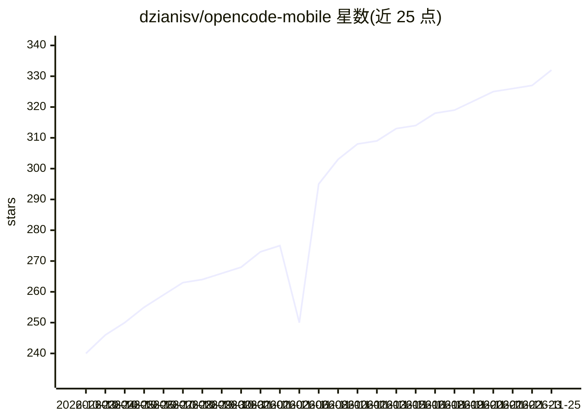

# dzianisv/opencode-mobile

⭐ 332 · TypeScript · MIT · 推送 2026-11-23 · [GitHub](https://github.com/dzianisv/opencode-mobile) · [官网](https://agentlabs.cc/opencode) · 组织维护

**手机上连接自托管 opencode 服务器的 Android AI 编码客户端**

基于 React Native / Expo 的开源 Android 客户端，通过 opencode 开放 HTTP+SSE API 连接用户自托管的 opencode 服务器，支持从手机浏览/创建/恢复编码会话、逐 token 流式聊天、查看文件变更 diff、审批或拒绝 agent 的工具调用。连接方式覆盖局域网、Cloudflare Tunnel、ngrok 与 Tailscale。模型调用与 API key 均由服务器端处理，客户端不代理代码或对话。提供离线演示模式、生物识别解锁、Android Keystore 凭据存储。仅支持 Android，iOS 不可用。

## 筛选速览

| 维度 | 判定 | 备注 |
|---|---|---|
| AI 角色 | `ai-ecosystem` | LLM/agent 周边工具 |
| 许可风险 | `permissive` | MIT |
| 部署形态 | `library` | 以包/库形式分发 |
| 模型依赖 | — | README 未给出锁定关系 |
| 硬件要求 | — | 无带数字的原话,不猜 |
| 安装摩擦 | `low` | 无编译、无系统依赖或容器化 |
| 成熟度 | — | 结构信号不足 |

## 能力要点

- 多服务器连接管理（局域网/Cloudflare Tunnel/ngrok/Tailscale）
- 流式聊天与文件变更 diff 查看器
- 工具调用执行前的审批 UI
- 生物识别解锁与 Android Keystore 凭据存储

## 适用场景

- 外出时用手机跟进并审批自托管编码 agent 的改动
- 通过 Tailscale 远程查看与继续本地开发机上的编码会话
- 无服务器时用离线演示模式了解 agent 工作流程

## 场景标签

`编码 Agent` · 领域:编码与开发

## 证据(README 行号)

> L3: **The open-source Android client for the opencode AI coding agent.**
> L94: OpenCode Mobile is a thin client. It speaks the opencode HTTP + SSE API: listing sessions, sending messages, stream
> L11: > **Not affiliated with opencode.** OpenCode Mobile is an independent, community-built client and is

## 星数曲线

2026-10-23 240 → 2026-11-25 332（+92）

---
*卡片 v1 · prompt 1.4 · 生成 2026-11-25 · 置信度 mid · 依据 README sha `177f559ae9bb` · [字段定义](../../DATASET.md)*
