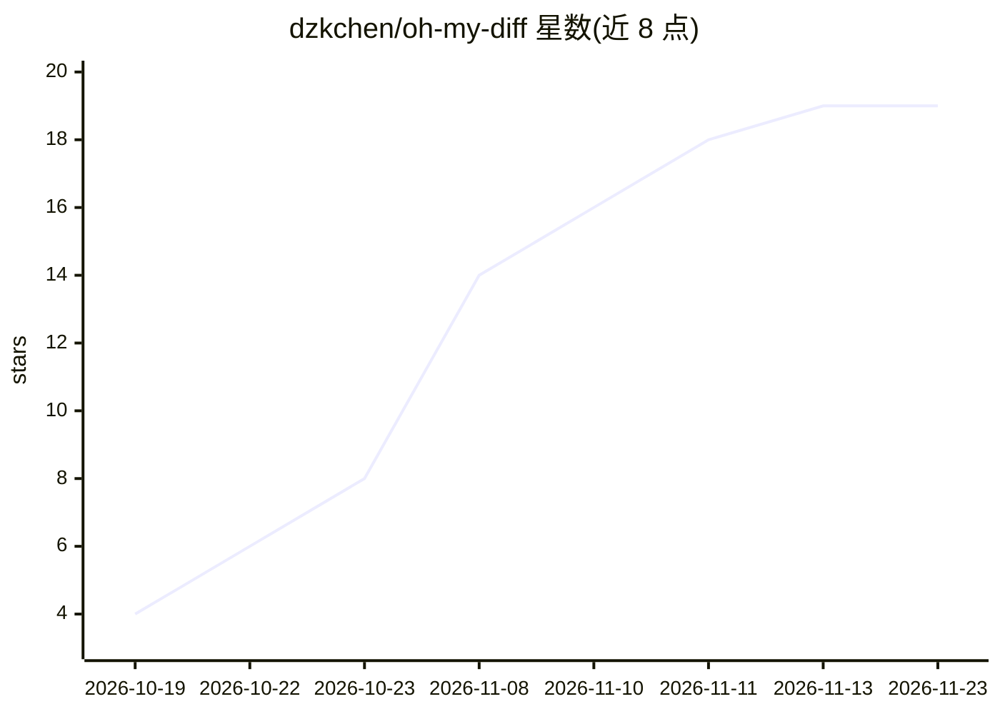

# dzkchen/oh-my-diff

⭐ 19 · Rust · MIT · 推送 2026-11-22 · [GitHub](https://github.com/dzkchen/oh-my-diff) · [官网](https://www.ohmydiff.me) · 个人维护

**Codex CLI 的 TypeScript 模组宿主：不改习惯即可扩展命令与工具**

在上游 Codex CLI 上打一个补丁，加入模组宿主：用户照常运行 codex，保留原有登录、设置与会话，可随时回到原版。模组是以 TypeScript 编写的小程序，可为模型添加斜杠命令、新工具、请求上下文、状态栏/面板，并在模组运行前展示其源码、许可与所需权限。OMD+ 附带分组工具行、状态栏、隐私脱敏、用量统计等内置模组；架构上每个模组运行在独立沙箱 runner 进程中。处于 beta 阶段，仅支持 Apple Silicon macOS。

## 筛选速览

| 维度 | 判定 | 备注 |
|---|---|---|
| AI 角色 | `ai-ecosystem` | LLM/agent 周边工具 |
| 许可风险 | `permissive` | MIT |
| 部署形态 | `library` | 以包/库形式分发 |
| 模型依赖 | — | README 未给出锁定关系 |
| 硬件要求 | — | 无带数字的原话,不猜 |
| 安装摩擦 | `low` | 无编译、无系统依赖或容器化 |
| 成熟度 | `idea` | |

## 能力要点

- TypeScript 模组可为 agent 添加命令、工具、上下文与界面组件
- 模组运行前展示源码、许可与权限申请，由用户控制
- 内置模组包括隐私脱敏、用量统计、状态栏、分组工具行等
- 每个模组运行在独立沙箱 runner 进程，补丁本身不含功能

## 适用场景

- 为 Codex CLI 添加自定义命令和工具而不修改其本体
- 在请求发送前对密钥和个人数据做脱敏
- 查看按请求的上下文、缓存、成本与配额用量

## 场景标签

 · 领域:开发者工具/AI 编程代理

## 证据(README 行号)

> L13:  Codex CLI with a host for TypeScript mods: add commands, tools, context and screens without leaving <code>codex</c
> L109: OMD is upstream Codex plus one patch pinned to a single Codex release. The patch adds a mod host

## 星数曲线

2026-10-19 4 → 2026-11-23 19（+15）

---
*卡片 v1 · prompt 1.4 · 生成 2026-11-18 · 置信度 mid · 依据 README sha `e4363720a3a2` · [字段定义](../../DATASET.md)*
