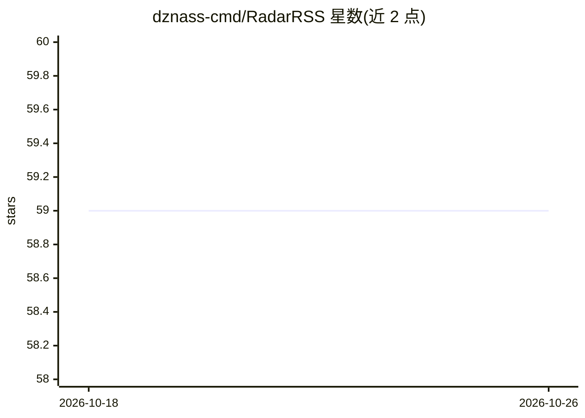

# dznass-cmd/RadarRSS

⭐ 59 · TypeScript · MIT · 推送 2026-09-10 · [GitHub](https://github.com/dznass-cmd/RadarRSS) · 个人维护 · 中文 README

**带 Gemini AI 摘要的实时 RSS 新闻聚合器（Windows/Android）**

面向新闻读者的跨平台 RSS 聚合应用：Node.js/Express 后端异步抓取 RSS/Atom 源，将文章组织为可自定义的模块化分类区块，内置多信号跨源故事聚类去重、智能图片提取、聚焦阅读模式、Windows Electron 桌面版（托盘、自动更新）与 Capacitor 原生 Android 应用（下拉刷新、TTS）。AI 部分接入 Google Gemini（@google/genai SDK）生成执行摘要、紧急度评估、突发新闻标记与多语言翻译；未配置 API key 时核心 RSS 阅读功能可正常运行，仅 AI 功能禁用。提供预编译安装包与 npm 源码构建两种途径。

## 筛选速览

| 维度 | 判定 | 备注 |
|---|---|---|
| AI 角色 | `ai-enhanced` | 去掉 AI 部分产品仍成立 |
| 许可风险 | `permissive` | MIT |
| 部署形态 | `desktop` | 安装包/桌面程序 |
| 模型依赖 | — | README 未给出锁定关系 |
| 硬件要求 | — | 无带数字的原话,不猜 |
| 安装摩擦 | `low` | 无编译、无系统依赖或容器化 |
| 成熟度 | — | 结构信号不足 |

## 能力要点

- 多信号相似度引擎做跨源故事聚类与去重（可配置策略与时间窗口）
- Gemini 生成执行摘要、突发新闻标记与多语言翻译
- Windows Electron 安装包/便携版与 Android APK，GitHub Releases 后台自动更新
- 无 API key 时核心 RSS 功能仍可运行，AI 功能优雅禁用

## 适用场景

- 一站式订阅并按主题区块浏览多个新闻源
- 用 AI 摘要快速了解跨源报道的统一简报
- 在 Windows 桌面或 Android 手机上离线安装使用

## 场景标签

`语音合成` · 领域:内容生成

## 证据(README 行号)

> L24: Powered by **Google Gemini Artificial Intelligence**, Radar RSS synthesizes executive bullet-point summaries, extra
> L111: > *Note:* If no API key is configured, all core RSS reading, live updating, custom feed management, and filtering 

## 星数曲线

2026-10-18 59 → 2026-10-26 59（+0）

---
*卡片 v1 · prompt 1.4 · 生成 2026-10-24 · 置信度 high · 依据 README sha `329a8ef85964` · [字段定义](../../DATASET.md)*
