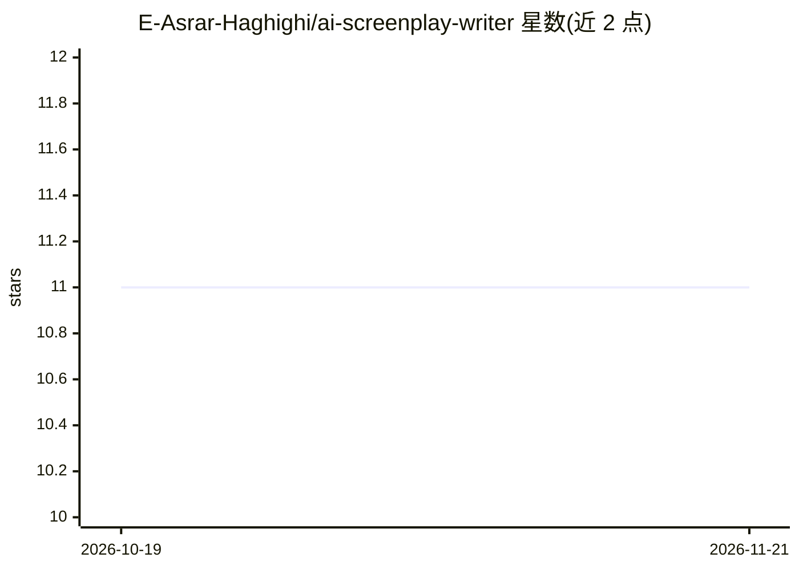

# E-Asrar-Haghighi/ai-screenplay-writer

⭐ 11 · Python · MIT · 推送 2026-03-12 · [GitHub](https://github.com/E-Asrar-Haghighi/ai-screenplay-writer) · 个人维护

**多智能体 AI 系统：整季生成原创电视剧剧本**

基于 LangGraph 状态机的多智能体剧本生成系统：将写作流程分解为场景规划、大纲校验、逐场景写作、脚本组装等节点，并配有一首集检查、连续性检查与编辑代理做质量控制。用户通过引导式流程建立"World Bible"（梗概、角色、世界规则），可用 rewrite 命令回滚重写、用 next season 命令续写多季，项目状态持久化到 final_state.json，生成的剧本以 .txt 文件输出。运行需 Python 3.9+ 与 OpenAI API Key。

## 筛选速览

| 维度 | 判定 | 备注 |
|---|---|---|
| AI 角色 | `ai-native` | 本体是模型或模型工具 |
| 许可风险 | `permissive` | MIT |
| 部署形态 | `library` | 以包/库形式分发 |
| 模型依赖 | — | README 未给出锁定关系 |
| 硬件要求 | — | 无带数字的原话,不猜 |
| 安装摩擦 | `low` | 无编译、无系统依赖或容器化 |
| 成熟度 | — | 结构信号不足 |

## 能力要点

- LangGraph 图架构编排多个专职写作代理，含大纲质量门与连续性检查
- 引导式 World Bible 设定：梗概、角色传记、地点与世界规则
- 持久化项目状态，支持 rewrite 回滚与 next season 多季续写
- 生成的每集剧本输出为结构化 .txt 文件

## 适用场景

- 从概念出发生成一整季电视剧剧本初稿
- 维护多季连载的世界观与剧情连续性
- 对指定剧集回滚重写以迭代故事方向

## 场景标签

`多智能体` `AI 写作` · 领域:Agent 开发

## 证据(README 行号)

> L5: This project is an advanced, multi-agent AI system designed to generate entire seasons of original TV series screenp
> L22: - **Multi-Agent "Writers' Room"**: The writing process is decomposed into a robust sub-graph of specialized agents:
> L42: The system is built as a state machine using LangGraph. The "state" is the entire TV series project. Specialized AI

## 星数曲线

2026-10-19 11 → 2026-11-21 11（+0）

---
*卡片 v1 · prompt 1.4 · 生成 2026-11-19 · 置信度 high · 依据 README sha `36c6eb7fecaf` · [字段定义](../../DATASET.md)*
