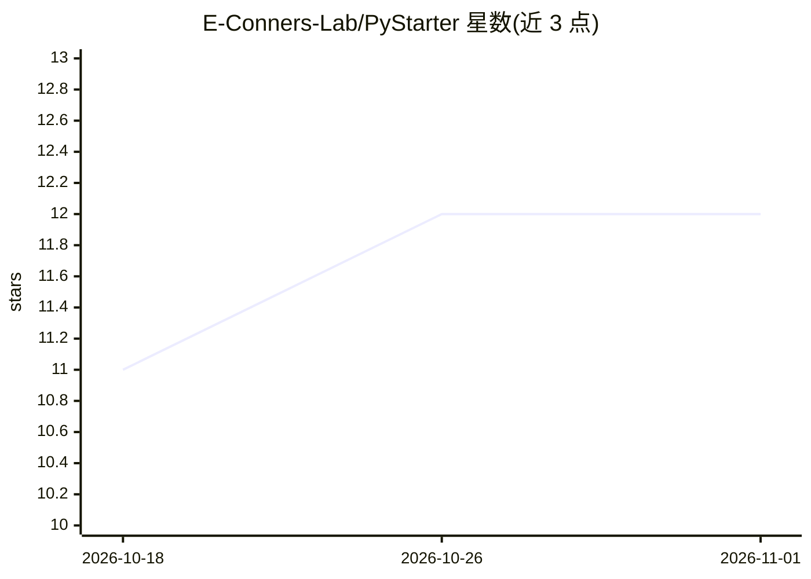

# E-Conners-Lab/PyStarter

⭐ 12 · Python · MIT · 推送 2026-10-26 · [GitHub](https://github.com/E-Conners-Lab/PyStarter) · 组织维护

**自托管的 Python 零基础教学平台：课程+练习+AI 提示**

面向 Python 零基础学习者的自托管教学平台（Django + React）：14 个模块、56 课、66 道评分练习，内置 Monaco 浏览器代码编辑器与沙箱执行（超时/输出限制/资源限制，但明确说明非硬安全边界，仅建议本地可信环境使用）。提供 XP 与 8 级段位进度、4 种题型、渐进提示。AI 功能（提示、代码点评、报错解释）为可选：接入 Anthropic Claude API 或任意 OpenAI 兼容本地模型（如 localhost:11434）。一条 docker compose 命令即可启动；项目声明 MIT 许可且不再维护，由部署者自行负责。

## 筛选速览

| 维度 | 判定 | 备注 |
|---|---|---|
| AI 角色 | `ai-enhanced` | 去掉 AI 部分产品仍成立 |
| 许可风险 | `permissive` | MIT |
| 部署形态 | `self-host` | docker 或自建部署 |
| 模型依赖 | locked-api |  |
| 硬件要求 | — | 无带数字的原话,不猜 |
| 安装摩擦 | `low` | 无编译、无系统依赖或容器化 |
| 成熟度 | — | 结构信号不足 |

## 能力要点

- 14 模块 56 课 66 道评分练习的完整课程体系（含网络工程师方向模块）
- 浏览器内 Monaco 编辑器 + 沙箱代码执行（Run/Submit 双模式，隐藏测试用例评分）
- AI 提示可选接入 Claude API 或 OpenAI 兼容本地模型，无 AI 时课程/评分/编辑器全部可用
- Docker Compose 一键部署，默认绑定 127.0.0.1，附带 Django + Playwright 测试套件

## 适用场景

- 零基础自学 Python，按课程+练习+XP 进度推进
- 教师/团队自托管一套可改课程内容的内部教学平台
- 本地可信环境下练习编程并获得 AI 报错解释与代码点评

## 场景标签

`教程课程` · 领域:学习与行业

## 证据(README 行号)

> L5: A self-hosted training platform that teaches Python from scratch through interactive lessons, a built-in code editor
> L105: Hints, code critique, and error explanations call an LLM. Everything else — lessons, exercises, the sandbox, XP, b
> L120: The tutor returns text only and has no execution tools. Core lessons, grading,

## 星数曲线

2026-10-18 11 → 2026-11-01 12（+1）

---
*卡片 v1 · prompt 1.4 · 生成 2026-11-01 · 置信度 high · 依据 README sha `2fcc24054964` · [字段定义](../../DATASET.md)*
