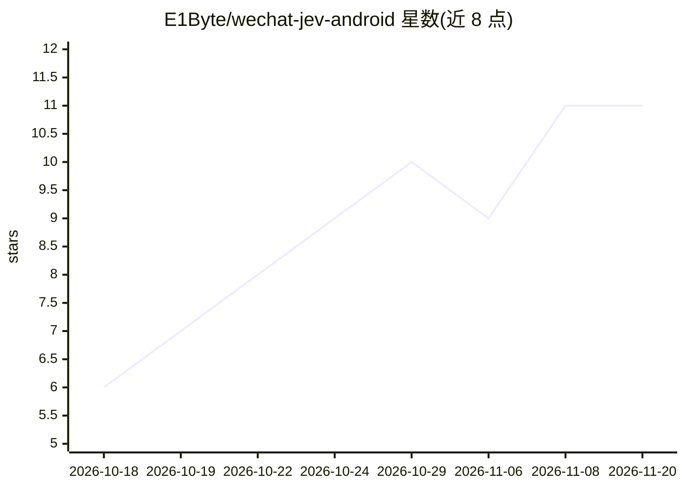

# E1Byte/wechat-jev-android

⭐ 11 · Kotlin · MIT · 推送 2026-09-27 · [GitHub](https://github.com/E1Byte/wechat-jev-android) · [官网](https://typesafe.ai) · 个人维护 · 中文 README

**微信一对一聊天实时分析助手：分析对方消息的情绪与意图**

基于 LSPosed/Xposed 的安卓模块，在微信进程内 Hook 聊天页，读取对方发来的纯文本消息，调用 TypeSafe 的 Jev 决策模型（/v1/systemone 端点）分析情绪、意图、潜台词、该不该回与关系危险度，结果以本地注入卡片显示在气泡下方。只读不发送消息，群聊与系统消息自动过滤，API key 由用户自填并本地存储。需 LSPosed（Root）或 LSPatch（免 Root）环境，自源码构建 APK。README 提示 Hook 微信违反其使用条款并有封号风险。

## 筛选速览

| 维度 | 判定 | 备注 |
|---|---|---|
| AI 角色 | `ai-native` | 本体是模型或模型工具 |
| 许可风险 | `permissive` | MIT |
| 部署形态 | `None` |  |
| 模型依赖 | — | README 未给出锁定关系 |
| 硬件要求 | — | 无带数字的原话,不猜 |
| 安装摩擦 | `medium` | 含编译或系统依赖之一 |
| 成熟度 | — | 结构信号不足 |

## 能力要点

- 调用 Jev 决策模型返回带类型的决策与置信度（Choice/Noul/Score）
- 情绪可叠加显示，每条消息多种情绪及各自概率分行展示
- 按行内头像位置判断消息方向，过滤自身消息与非文本内容
- 无三方网络依赖，HttpURLConnection 直连，支持官方端点或自建中转

## 适用场景

- 在微信一对一聊天中查看对方消息的情绪与意图分析
- 自建中转站环境下接入 Jev 决策模型
- 免 Root 设备用 LSPatch 打补丁后运行分析

## 场景标签

`AI 助手` · 领域:对话与助手

## 证据(README 行号)

> L3: 安卓版「微信一对一好友聊天实时分析助手」。基于 **LSPosed/Xposed** 在微信进程内 Hook，
> L4: 实时读取**对方发来的纯文本消息**，用 **TypeSafe AI 的 Jev**（System One 决策模型）分析
> L13: - **决策模型而非聊天模型**：Jev 吃「状态 + 带类型的问题」，吐「带类型的决策 + 置信度」

## 星数曲线

2026-10-18 6 → 2026-11-20 11（+5）

---
*卡片 v1 · prompt 1.4 · 生成 2026-11-19 · 置信度 high · 依据 README sha `06715077d060` · [字段定义](../../DATASET.md)*
