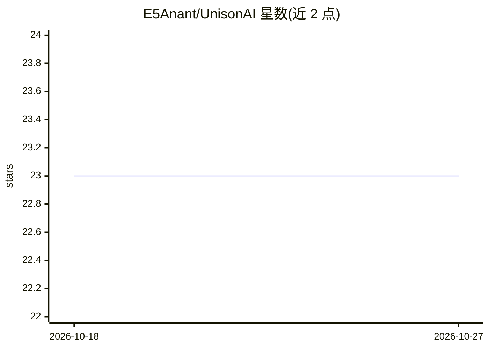

# E5Anant/UnisonAI

⭐ 23 · Python · Apache-2.0 · 推送 2026-02-24 · [GitHub](https://github.com/E5Anant/UnisonAI) · [官网](https://pypi.org/project/unisonai/) · 个人维护

**构建单/多智能体系统的轻量 Python 框架**

UnisonAI 是一个用于构建单智能体与多智能体系统的 Python 框架。核心组件包括 Agent（独立运行或加入 Clan，支持工具集成与会话历史）、Clan（多智能体编排，含自动规划、任务分发与内置 A2A 消息机制）以及工具系统（@tool 装饰器或 BaseTool 类，带类型校验）。支持 Gemini、OpenAI、Anthropic、Cohere、Groq、xAI、Cerebras 等模型，可扩展 BaseLLM 接入自定义模型；API key 可用环境变量或构造函数传入。面向需要协调多个自主智能体的开发者。

## 筛选速览

| 维度 | 判定 | 备注 |
|---|---|---|
| AI 角色 | `ai-ecosystem` | LLM/agent 周边工具 |
| 许可风险 | `permissive` | Apache-2.0 |
| 部署形态 | `library` | 以包/库形式分发 |
| 模型依赖 | locked-api |  |
| 硬件要求 | — | 无带数字的原话,不猜 |
| 安装摩擦 | `low` | 无编译、无系统依赖或容器化 |
| 成熟度 | — | 结构信号不足 |

## 能力要点

- Clan 多智能体编排：自动规划、任务分发与内置 A2A 通信
- 工具系统支持 @tool 装饰器与 BaseTool 类两种创建方式，带类型校验
- 支持 Gemini/OpenAI/Anthropic/Cohere/Groq/xAI/Cerebras，可扩展 BaseLLM 接入自定义模型

## 适用场景

- 多个专业智能体协作完成研究、写作、数据分析等多步任务
- 为智能体挂载自定义工具扩展能力
- 用单一框架统一管理独立智能体与智能体集群

## 场景标签

`Agent 框架` `多智能体` · 领域:Agent 开发

## 证据(README 行号)

> L7: UnisonAI is a lightweight Python framework for building single-agent and multi-agent AI systems.
> L10: - **Clan** — coordinate multiple agents on a shared goal with built-in A2A messaging.

## 星数曲线

2026-10-18 23 → 2026-10-27 23（+0）

---
*卡片 v1 · prompt 1.4 · 生成 2026-10-27 · 置信度 high · 依据 README sha `87730b2a2abb` · [字段定义](../../DATASET.md)*
