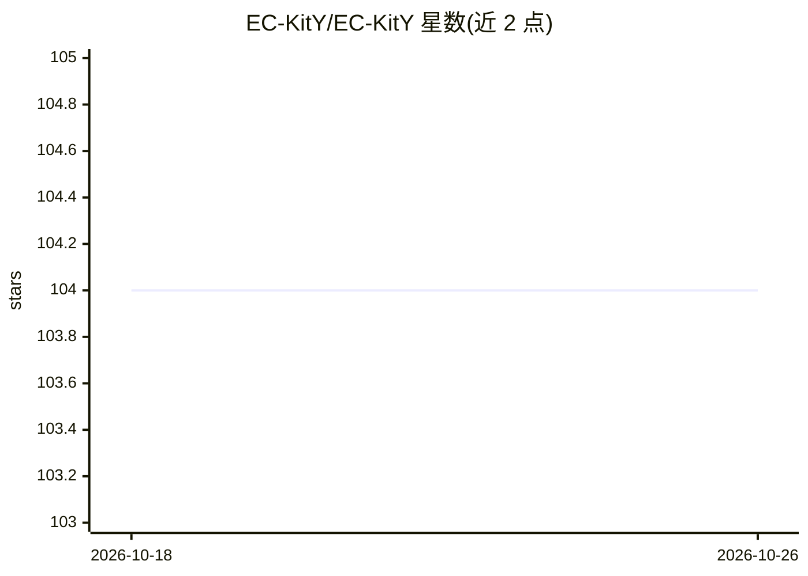

# EC-KitY/EC-KitY

⭐ 104 · Python · BSD-3-Clause · 推送 2026-10-06 · [GitHub](https://github.com/EC-KitY/EC-KitY) · [官网](https://www.eckity.org) · 组织维护

**scikit-learn 兼容的 Python 进化计算工具包**

提供遗传算法（GA）与基于树的遗传编程（GP）实现的 Python 进化计算工具包，支持 sklearn（ML）模式与非 sklearn 基础模式两种使用方式，设计上计划支持 ES、协同进化、多目标等更多 EC 范式。基础示例仅需 3 行代码即可运行符号回归的进化算法。面向需要在 Python 中运行进化算法并可能接入 scikit-learn 生态的开发者与研究者，文档与教程标注为进行中（部分模块尚未文档化）。

## 筛选速览

| 维度 | 判定 | 备注 |
|---|---|---|
| AI 角色 | `ai-native` | 本体是模型或模型工具 |
| 许可风险 | `permissive` | BSD-3-Clause |
| 部署形态 | `library` | 以包/库形式分发 |
| 模型依赖 | — | README 未给出锁定关系 |
| 硬件要求 | — | 无带数字的原话,不猜 |
| 安装摩擦 | `low` | 无编译、无系统依赖或容器化 |
| 成熟度 | — | 结构信号不足 |

## 能力要点

- 实现遗传算法（GA）与树遗传编程（GP）
- 与 scikit-learn 兼容，支持 sklearn 与非 sklearn 两种模式
- 基础示例 3 行代码即可运行 EA 符号回归

## 适用场景

- 用遗传编程做符号回归
- 在 scikit-learn 流水线中接入进化算法
- 用 GA 求解优化/调度类问题

## 场景标签

 · 领域:进化计算/机器学习库

## 证据(README 行号)

> L4: **EC-KitY** is a Python toolkit for evolutionary computation and is scikit-learn-compatible.
> L6: Currently, we have implemented Genetic Algorithm (GA) and tree-based Genetic Programming (GP), but EC-KitY will grow
> L13: - Can work with or without scikit-learn, i.e., supports both sklearn (ML) and non-sklearn (basic) modes

## 星数曲线

2026-10-18 104 → 2026-10-26 104（+0）

---
*卡片 v1 · prompt 1.4 · 生成 2026-10-23 · 置信度 high · 依据 README sha `9059c91f44b1` · [字段定义](../../DATASET.md)*
