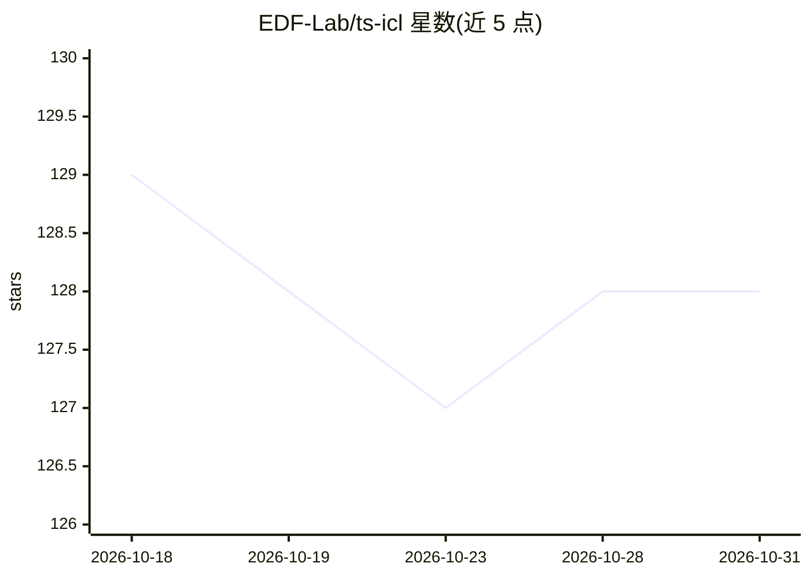

# EDF-Lab/ts-icl

⭐ 128 · Python · NOASSERTION · 推送 2026-07-17 · [GitHub](https://github.com/EDF-Lab/ts-icl) · [官网](https://edf-lab.github.io/ts-icl/) · 组织维护

**时间序列基础模型：零样本统一预测与缺失值填补**

TS-ICL 是一个连续概率型时间序列基础模型（TSFM），在单一零样本架构内统一预测与填补两类任务，无需任务专属训练或微调。架构含时间序列编码器（压缩为 32 个潜在 token）、通道混合器、Fourier 时间上下文查询模块（支持不规则时间网格任意时间戳预测）与因果 Transformer 上下文回归器（输出 99 个分位数）。原生处理 NaN，单 checkpoint 含填补与预测两个专项组件。以 pip 包发布，模型权重托管于 HuggingFace，权重与代码采用非商业许可。

## 筛选速览

| 维度 | 判定 | 备注 |
|---|---|---|
| AI 角色 | `ai-native` | 本体是模型或模型工具 |
| 许可风险 | `none` | NOASSERTION |
| 部署形态 | `library` | 以包/库形式分发 |
| 模型依赖 | — | README 未给出锁定关系 |
| 硬件要求 | — | 无带数字的原话,不猜 |
| 安装摩擦 | `low` | 无编译、无系统依赖或容器化 |
| 成熟度 | — | 结构信号不足 |

## 能力要点

- 单一零样本架构统一预测与填补，无需任务专属训练
- Fourier 位置编码支持任意时间戳与不规则网格预测
- 因果 Transformer 上下文回归器输出 99 个分位数
- 原生处理 NaN 缺失值，无需预处理

## 适用场景

- 对时间序列做零样本点预测与分位数区间预测
- 填补含点缺失或块缺失的时间序列（含协变量感知）
- 不规则采样时间戳上的概率预测

## 场景标签

 · 领域:时间序列机器学习

## 证据(README 行号)

> L12: **TS-ICL** is a continuous probabilistic Time Series Foundation Model (TSFM) that unifies **forecasting** and **imp
> L24: **Requirements:** Python ≥ 3.12, PyTorch ≥ 2.5.1

## 星数曲线

2026-10-18 129 → 2026-10-31 128（-1）

---
*卡片 v1 · prompt 1.4 · 生成 2026-10-23 · 置信度 high · 依据 README sha `3e06b83afe69` · [字段定义](../../DATASET.md)*
