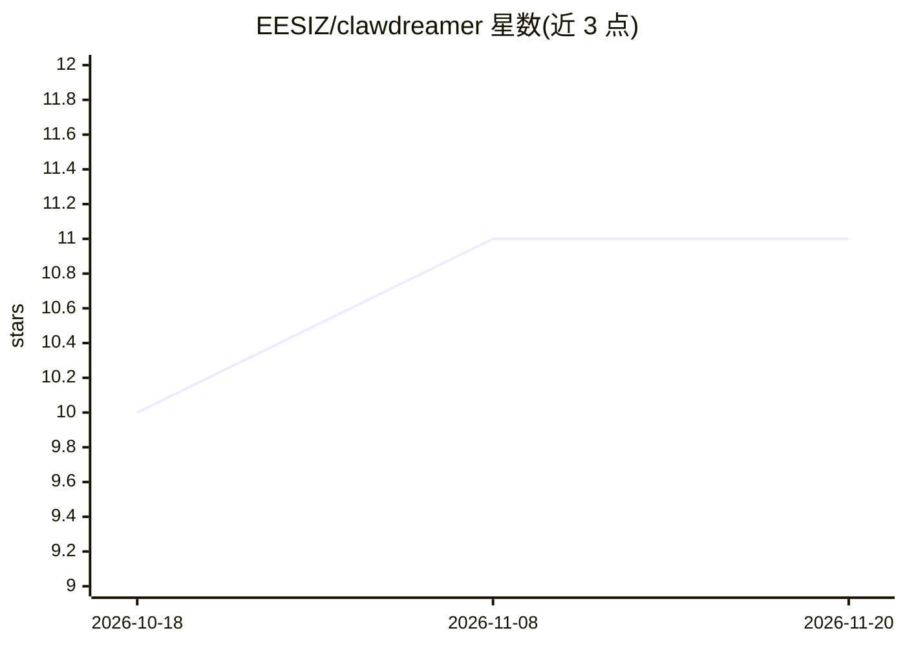

# EESIZ/clawdreamer

⭐ 11 · Python · MIT · 推送 2026-10-01 · [GitHub](https://github.com/EESIZ/clawdreamer) · 个人维护

**为 AI agent 提供夜间记忆压缩与整合的后台工具**

仿照睡眠神经科学的 NREM/REM 阶段设计的 agent 记忆整合作业：每日凌晨读取会话产生的 markdown episode 文件，分块、嵌入聚类、LLM 提炼为语义记忆存入 LanceDB，检测新旧记忆冲突并按 state_change/different_aspects 分类合并，对未召回记忆施加重要性衰减并软删除，每轮生成 markdown 审计报告。为 OpenClaw 设计，也可对接任何产出日志 markdown 的系统；以 Python 脚本按 cron/systemd 定时运行，错误通过 Telegram/Slack/webhook 直接通知运维者。

## 筛选速览

| 维度 | 判定 | 备注 |
|---|---|---|
| AI 角色 | `ai-ecosystem` | LLM/agent 周边工具 |
| 许可风险 | `permissive` | MIT |
| 部署形态 | `library` | 以包/库形式分发 |
| 模型依赖 | local-ok | 支持本地模型 |
| 硬件要求 | — | 无带数字的原话,不猜 |
| 安装摩擦 | `low` | 无编译、无系统依赖或容器化 |
| 成熟度 | — | 结构信号不足 |

## 能力要点

- NREM/REM/Dream Log 三阶段记忆整合流程
- LanceDB 存储 1536 维语义记忆，支持去重与冲突合并
- 重要性衰减与软删除机制控制记忆规模
- 嵌入与 LLM 提供者可选 openai/ollama/sentence-transformers/minimax

## 适用场景

- 为 OpenClaw agent 做每日记忆压缩与去重
- 解决长期记忆库无限增长导致的 token 消耗
- 希望 agent 记忆有审计日志的运维场景
- 自建 markdown 日记系统的 agent 记忆整合

## 场景标签

`Agent 记忆` · 领域:Agent 开发

## 证据(README 行号)

> L16: **Dreamer gives your AI agent the ability to dream.**
> L71: Dreamer is designed to work with OpenClaw's memory system. Here's how the pieces fit together:
> L91: - **memory-lancedb**: Stores semantic memories as 1536-dim vectors in LanceDB. The gateway reads/writes to the same

## 星数曲线

2026-10-18 10 → 2026-11-20 11（+1）

---
*卡片 v1 · prompt 1.4 · 生成 2026-11-19 · 置信度 mid · 依据 README sha `9e484a8dd4e2` · [字段定义](../../DATASET.md)*
