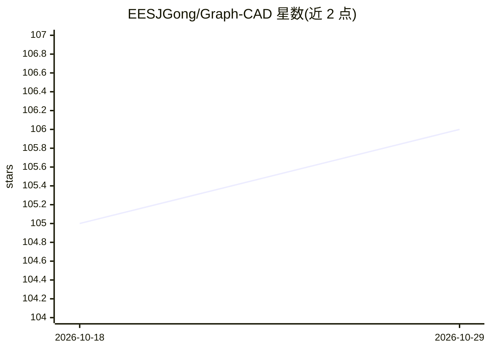

# EESJGong/Graph-CAD

⭐ 106 · Python · 推送 2026-03-30 · [GitHub](https://github.com/EESJGong/Graph-CAD) · 组织维护

**图结构中介的 Text-to-CAD 框架：自然语言生成可执行 Blender 代码**

ICLR 2026 论文的官方代码库：将文本到 CAD 的生成分解为三阶段流水线（指令→层次几何分解图→CAD 操作序列→可执行 bpy 代码），以 Qwen3-8B 为基座模型、LlamaFactory 做本地服务与微调，配套 BlendGeo 数据集（12K 规模）与 CADBench 基准。训练上采用 SAPCL 课程学习机制，交替 SFT 与难度渐进探索。推理通过 infer_api.py 运行，需本地准备 qwen3 基座、三阶段适配器、prompt 目录与 Blender 4.4.1；评估需外部模型 API（base URL/key/model）。面向 CAD 生成方向的研究者。

## 筛选速览

| 维度 | 判定 | 备注 |
|---|---|---|
| AI 角色 | `ai-native` | 本体是模型或模型工具 |
| 许可风险 | `none` | — |
| 部署形态 | `None` |  |
| 模型依赖 | — | README 未给出锁定关系 |
| 硬件要求 | — | 无带数字的原话,不猜 |
| 安装摩擦 | `low` | 无编译、无系统依赖或容器化 |
| 成熟度 | `idea` | |

## 能力要点

- 三阶段推理：几何分解图→CAD 操作序列→可执行 bpy 代码
- SAPCL 结构感知渐进课程学习（SFT 与课程探索交替）
- BlendGeo 12K 数据集：指令、分解图、操作序列与 Blender 代码配对
- 提供 CADBench 基准与渲染、评测脚本

## 适用场景

- 按论文复现 Text-to-CAD 三阶段生成流水线
- 在 CADBench 上评测生成代码的几何约束满足与渲染质量
- 基于开源权重与适配器做自然语言到 Blender CAD 模型的生成研究

## 场景标签

`代码生成` · 领域:编码与开发

## 证据(README 行号)

> L20: Graph-CAD is a graph-mediated Text-to-CAD framework for long-horizon CAD code generation. Instead of directly decod
> L61: As in Figure 2 of the paper, Graph-CAD decomposes Text-to-CAD generation into three sequential stages. In **Stage 1

## 星数曲线

2026-10-18 105 → 2026-10-29 106（+1）

---
*卡片 v1 · prompt 1.4 · 生成 2026-10-23 · 置信度 high · 依据 README sha `fbdf00ce9d96` · [字段定义](../../DATASET.md)*
