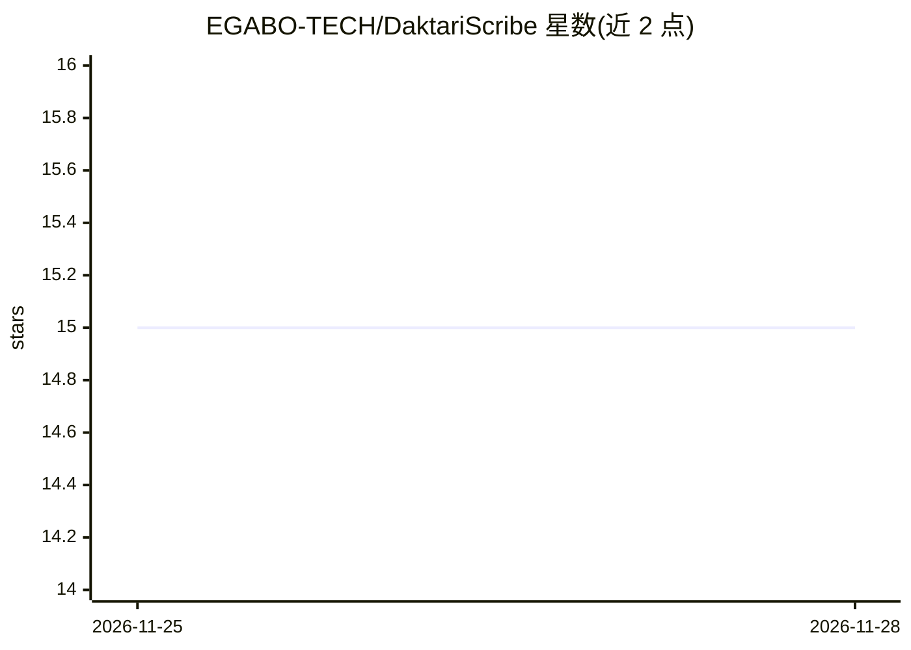

# EGABO-TECH/DaktariScribe

⭐ 15 · TypeScript · 推送 2026-11-07 · [GitHub](https://github.com/EGABO-TECH/DaktariScribe) · [官网](https://daktariscribe.vercel.app) · 组织维护

**面向偏远地区一线医护的离线临床记录与报告工具**

为偏远低联网环境（医疗营地、农村卫生中心）的一线医护人员设计的临床文档工具：通过语音、打字或文件上传采集诊疗记录，支持离线使用与设备端加密存储，联网后上传处理。笔记被整理进模板化标准记录，每行链接回原文并有防编造校验，医生审核签署后可导出 PDF/Word/幻灯片。转录支持英语与乌干达语言（AssemblyAI/Sunbird AI），整理步骤使用任意免费 LLM API key，无 key 时以原始笔记作为草稿。基于 Next.js + Neon Postgres，含组织角色、计费与审计模块。

## 筛选速览

| 维度 | 判定 | 备注 |
|---|---|---|
| AI 角色 | `ai-native` | 本体是模型或模型工具 |
| 许可风险 | `none` | — |
| 部署形态 | `library` | 以包/库形式分发 |
| 模型依赖 | — | README 未给出锁定关系 |
| 硬件要求 | — | 无带数字的原话,不猜 |
| 安装摩擦 | `low` | 无编译、无系统依赖或容器化 |
| 成熟度 | `idea` | |

## 能力要点

- 语音/文本/文件上传三种采集方式，离线加密存储、联网后同步
- 英语用 AssemblyAI Medical Mode，乌干达语言用 Sunbird AI 转录，带引擎回退
- 整理结果逐行溯源原文，代码校验拦截编造的数字、剂量、日期与否定丢失
- AES-256-GCM 加密、组织级访问控制、审计日志与签署门禁

## 适用场景

- 在无网络的农村卫生中心用语音采集诊疗记录
- 对门诊记录逐行核对原文后签署导出 PDF 报告
- 按营地与日期组织记录并向监督者汇总图表

## 场景标签

 · 领域:医疗健康/临床文档

## 证据(README 行号)

> L147: |**Organising**|Notes are tidied into the template. Every line links to the exact original text; code checks block
> L148: |**Transcription**|English: AssemblyAI (Medical Mode, speaker labels, keyterms). Ugandan/African languages: Sunbir
> L27: **DaktariScribe** is a **clinical documentation and reporting tool** designed specifically for frontline healthcare

## 星数曲线

2026-11-25 15 → 2026-11-28 15（+0）

---
*卡片 v1 · prompt 1.4 · 生成 2026-11-24 · 置信度 high · 依据 README sha `e4ecc32e15de` · [字段定义](../../DATASET.md)*
