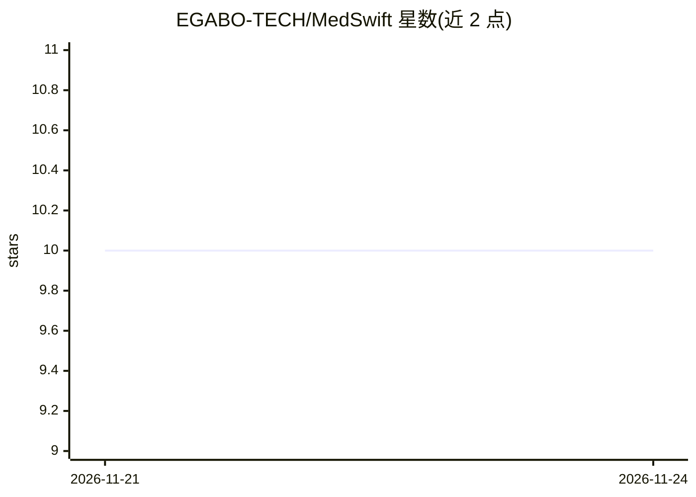

# EGABO-TECH/MedSwift

⭐ 10 · JavaScript · MIT · 推送 2026-08-31 · [GitHub](https://github.com/EGABO-TECH/MedSwift) · [官网](https://med-swift-app.vercel.app/) · 组织维护

**面向临床与供应链的摄像头药品识别审计 PWA**

多模态药品审计 Web 应用：用手机摄像头拍摄药品包装，通过 OCR 预处理与分层 Gemini 推理管线输出药品身份、真伪核查与剂量/警示/储存信息，并与 openFDA、EMA、Health Canada DPD、DrugBank、ChEMBL、WHO EML 等数据源交叉核验。支持生成 PDF 审计报告、IndexedDB 本地视觉签名库实现已识别药品的离线验证，以 PWA + Vercel Serverless 形式部署，AI 密钥经后端代理保护。

## 筛选速览

| 维度 | 判定 | 备注 |
|---|---|---|
| AI 角色 | `ai-native` | 本体是模型或模型工具 |
| 许可风险 | `permissive` | MIT |
| 部署形态 | `None` |  |
| 模型依赖 | locked-api |  |
| 硬件要求 | — | 无带数字的原话,不猜 |
| 安装摩擦 | `low` | 无编译、无系统依赖或容器化 |
| 成熟度 | — | 结构信号不足 |

## 能力要点

- 三层推理管线：Gemini 2.0 Flash / 1.5 Pro / OpenRouter 兜底
- 零样本药品识别与 Truth Report 临床卡片生成
- openFDA/EMA/WHO EML 等多数据源交叉审计
- IndexedDB 视觉签名库支持已识别药品离线验证

## 适用场景

- 用药前扫描包装核验药品身份与剂量说明
- 供应链审计时生成可导出的 PDF 核验报告
- 低 connectivity 环境下对已识别药品做离线验证

## 场景标签

`多模态` `OCR` · 领域:感知与多模态

## 证据(README 行号)

> L5: **MedSwift** is an enterprise-grade **Multimodal Pharmaceutical Intelligence Engine** and Progressive Web App (PWA) 
> L30: * **Zero-Shot Identification**: Instant classification of medications from live video or image uploads.

## 星数曲线

2026-11-21 10 → 2026-11-24 10（+0）

---
*卡片 v1 · prompt 1.4 · 生成 2026-11-21 · 置信度 high · 依据 README sha `030eb9bcfea7` · [字段定义](../../DATASET.md)*
