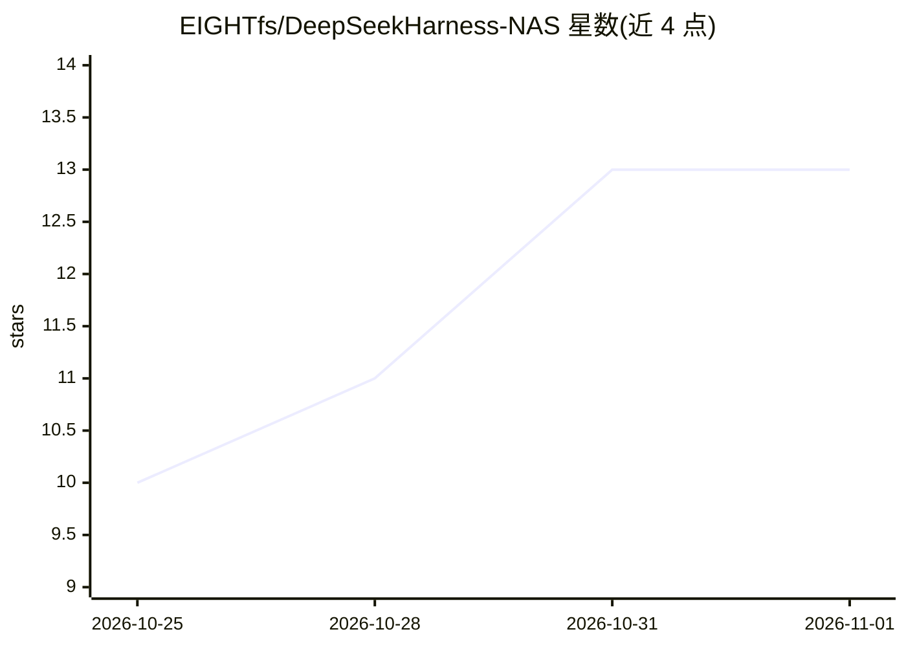

# EIGHTfs/DeepSeekHarness-NAS

⭐ 13 · Shell · 推送 2026-10-28 · [GitHub](https://github.com/EIGHTfs/DeepSeekHarness-NAS) · [官网](https://deepseek-ai.github.io/deepseek-harness/) · 个人维护 · 中文 README

**DeepSeek Harness 的群晖 DSM / 飞牛 fnOS NAS 原生安装包**

DeepSeek Harness（DSH，DeepSeek AI 开源的 Agent 框架）的 NAS 平台适配包仓库：将 DSH 打包为群晖 DSM (.spk) 与飞牛 fnOS (.fpk) 安装包，无需 Docker，内置反向代理、Web UI 管理与仅放行私网 IP 的局域网访问限制。构建链路包括公共预编译、白名单裁剪、依赖闭包补齐、npm/源码双链路打包，通过 GitHub Actions 发版。限制：ARM 版未经实际部署测试，x86 仅部分版本真机验收，升级/覆盖安装路径未实测，作者声明不保证未实测版本可用。

## 筛选速览

| 维度 | 判定 | 备注 |
|---|---|---|
| AI 角色 | `ai-ecosystem` | LLM/agent 周边工具 |
| 许可风险 | `permissive` | — |
| 部署形态 | `library` | 以包/库形式分发 |
| 模型依赖 | locked-api |  |
| 硬件要求 | — | 无带数字的原话,不猜 |
| 安装摩擦 | `low` | 无编译、无系统依赖或容器化 |
| 成熟度 | `idea` | |

## 能力要点

- DSH 的 SPK/FPK 双平台 NAS 原生打包，无需 Docker
- 内置透明反向代理与局域网安全限制（公网访问 403）
- pnpm 白名单裁剪与运行时依赖闭包补齐的构建链路
- 支持 x86_64 与 arm64 架构参数化构建

## 适用场景

- 我在群晖或飞牛 NAS 上原生安装运行 DeepSeek Harness
- 通过 Web UI 在局域网内管理 DSH 多模型配置
- 用脚本从源码自行构建 SPK/FPK 安装包

## 场景标签

`Agent 框架` · 领域:Agent 开发

## 证据(README 行号)

> L3: > DeepSeek Harness 的群晖 DSM (.spk) / 飞牛 fnOS (.fpk) 平台适配包 — NAS 原生运行 DeepSeek Harness，无需 Docker
> L67: DeepSeek Harness (DSH) 是 DeepSeek AI 官方开源的 Agent 框架，提供 Web UI 管理界面，支持多模型配置、自定义 OpenAI 兼容端点。本仓库提供群晖 DSM (.spk) 与飞牛 f

## 星数曲线

2026-10-25 10 → 2026-11-01 13（+3）

---
*卡片 v1 · prompt 1.4 · 生成 2026-10-31 · 置信度 mid · 依据 README sha `e47fb508225a` · [字段定义](../../DATASET.md)*
