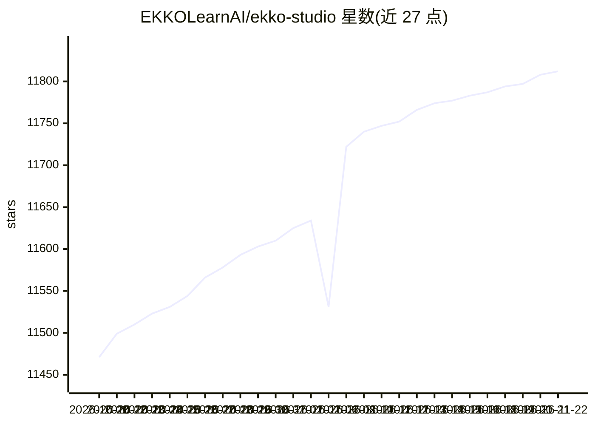

# EKKOLearnAI/ekko-studio

⭐ 11,812 · TypeScript · NOASSERTION · 推送 2026-11-21 · [GitHub](https://github.com/EKKOLearnAI/ekko-studio) · [官网](https://ekkostudio.xyz) · 组织维护 · 中文 README

**本地优先的多 Agent 工作区：聊天、编码与可视化流程统一管理**

以桌面应用（Windows/macOS/Linux）、npm CLI 与 Docker 镜像三种形式分发的本地优先工作区，统一接入 Hermes Agent、Ekko Agent 与 14 个编码类 Agent（如 Claude Code、Codex），提供单聊、群聊、可视化工作流、定时任务、看板、文件浏览器、Web 终端与用量统计。会话数据存于本地 SQLite；支持 Telegram/Discord/Slack 等 10 个平台通道配置与多 Profile 管理。编码类 Agent 的 CLI 需安装在承载 Studio 后端的机器上。

## 筛选速览

| 维度 | 判定 | 备注 |
|---|---|---|
| AI 角色 | `ai-ecosystem` | LLM/agent 周边工具 |
| 许可风险 | `none` | NOASSERTION |
| 部署形态 | `self-host` | docker 或自建部署 |
| 模型依赖 | locked-api |  |
| 硬件要求 | — | 无带数字的原话,不猜 |
| 安装摩擦 | `low` | 无编译、无系统依赖或容器化 |
| 成熟度 | — | 结构信号不足 |

## 能力要点

- 接入 Hermes/Ekko 与 14 个编码 Agent 集成，含 Agent Manager 统一安装与更新
- Vue Flow 可视化工作流：条件分支、循环、审批门与执行快照回放
- 10 个平台通道（Telegram/Discord/Slack/飞书/钉钉/QQBot/微信等）统一配置
- 模型管理：从凭据池自动发现模型，支持 OpenAI 兼容自定义 Provider 与 OAuth 设备流

## 适用场景

- 在同一界面统一使用和管理多个编码 Agent 与聊天 Agent
- 用可视化工作流把多个 Agent 步骤串起来并加人工审批环节
- 把 Agent 接入 Telegram/飞书/微信等平台作为机器人响应
- 团队按 Profile 隔离配置、会话与用量，并跟踪 Token 成本

## 场景标签

`多智能体` `编码 Agent` `工作流自动化` `聊天机器人` · 领域:Agent 开发

## 证据(README 行号)

> L4:  A local-first AI workspace for multi-agent chat, coding, and visual workflows.
> L39: |Multi-agent runtime|Connects the agents listed below with streaming responses, tool traces, generated-file preview
> L44: |Distribution|Ships as a desktop app for Windows/macOS/Linux, an npm CLI package, and a Docker image.|

## 星数曲线

2026-10-20 11,471 → 2026-11-22 11,812（+341）

---
*卡片 v1 · prompt 1.4 · 生成 2026-11-22 · 置信度 mid · 依据 README sha `e6734dbfd061` · [字段定义](../../DATASET.md)*
