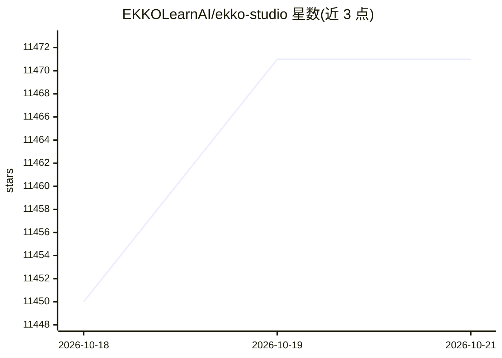

# EKKOLearnAI/ekko-studio

⭐ 11,471 · TypeScript · NOASSERTION · 推送 2026-10-19 · [GitHub](https://github.com/EKKOLearnAI/ekko-studio) · [官网](https://ekkostudio.xyz) · 组织维护 · 中文 README

**本地优先的多 Agent 聊天、编程与可视化工作流 AI 工作台**

Ekko Studio 是 local-first 的 AI 工作区，提供桌面应用（Windows/macOS/Linux）、npm CLI 包与 Docker 镜像三种分发形式。核心功能：多 Agent 对话（单聊/群聊）、可视化工作流（Vue Flow 画布、审批门、条件路由）、Agent Manager 管理 14 种编程 Agent 集成（Claude Code、Codex、Cursor 等）、平台频道接入（Telegram/Discord/飞书/钉钉/QQ/微信等 10 个）、定时任务、看板、文件浏览器与用量分析。内置 Ekko Agent，桌面与 Docker 版捆绑 Hermes 运行时；会话数据存本地 SQLite。曾用名 Hermes Studio / Hermes Web UI。

## 筛选速览

| 维度 | 判定 | 备注 |
|---|---|---|
| AI 角色 | `ai-ecosystem` | LLM/agent 周边工具 |
| 许可风险 | `none` | NOASSERTION |
| 部署形态 | `self-host` | docker 或自建部署 |
| 模型依赖 | — | README 未给出锁定关系 |
| 硬件要求 | — | 无带数字的原话,不猜 |
| 安装摩擦 | `low` | 无编译、无系统依赖或容器化 |
| 成熟度 | — | 结构信号不足 |

## 能力要点

- 14 种编程 Agent 集成，含安装/更新/配置管理（Agent Manager）
- 可视化工作流画布：条件路由、审批门、执行快照回放
- 10 个平台频道统一配置（Telegram/Discord/Slack/飞书/钉钉/QQ/微信等）
- 桌面应用（Windows/macOS/Linux）、npm CLI 与 Docker 三种分发形式

## 适用场景

- 在一个界面里统一使用和切换多个编程 Agent 与对话 Agent
- 搭建多 Agent 群聊与可视化自动化工作流
- 将 Agent 接入 Telegram/Discord/微信等平台频道

## 场景标签

`多智能体` `工作流自动化` `编码 Agent` `聊天机器人` · 领域:Agent 开发

## 证据(README 行号)

> L4:  A local-first AI workspace for multi-agent chat, coding, and visual workflows.
> L6:  Hermes Agent, Ekko Agent, and 14 coding-agent integrations, including Claude Code and Codex.
> L49: |Multi-agent runtime|Connects the agents listed below with streaming responses, tool traces, generated-file preview

## 星数曲线

2026-10-18 11,450 → 2026-10-21 11,471（+21）

---
*卡片 v1 · prompt 1.4 · 生成 2026-10-20 · 置信度 mid · 依据 README sha `e7139526354f` · [字段定义](../../DATASET.md)*
