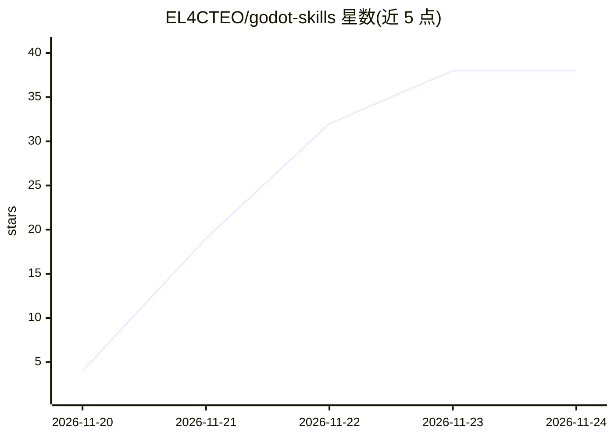

# EL4CTEO/godot-skills

⭐ 38 · Python · MIT · 推送 2026-11-21 · [GitHub](https://github.com/EL4CTEO/godot-skills) · 个人维护

**面向 AI 编码 agent 的 Godot 4.7 技能包（18 个）**

为 Claude Code、Codex、Cursor 等编码 agent 提供 18 个基于 Godot 4.7.2 的技能：从本机安装的引擎查证精确 API、通过 Godot 自身安全编辑场景、用真实编译/测试/导出运行校验结果，技能内代码示例均经 Godot 4.7.2 测试套件编译验证。覆盖 GDScript 与 C#/.NET，含 2D/3D、物理、动画、着色器、网络、导出 CI、XR 等主题。要求 Godot 4.7+ 与 Python 3.9+，C# 需 .NET 8+ SDK。

## 筛选速览

| 维度 | 判定 | 备注 |
|---|---|---|
| AI 角色 | `ai-knowledge` | 知识聚合/清单类 |
| 许可风险 | `permissive` | MIT |
| 部署形态 | `None` |  |
| 模型依赖 | — | README 未给出锁定关系 |
| 硬件要求 | — | 无带数字的原话,不猜 |
| 安装摩擦 | `medium` | 含编译或系统依赖之一 |
| 成熟度 | — | 结构信号不足 |

## 能力要点

- 18 个技能覆盖 GDScript 与 C#/.NET 的引擎开发全流程
- 从用户本机安装的 Godot 引擎查证精确 API 而非猜测
- 通过 Godot 本体安全编辑场景，并用真实编译/测试/导出校验
- 技能内全部代码示例经 Godot 4.7.2 测试套件编译

## 适用场景

- 让编码 agent 用 Godot 开发 2D/3D 游戏项目
- 升级到 Godot 4.7 后让 agent 修复 C# 构建错误
- 让 agent 生成主菜单并完成 Windows/Android 导出

## 场景标签

`编码 Agent` · 领域:编码与开发

## 证据(README 行号)

> L11: Godot **4.7** skills for AI coding agents (Claude Code, Codex, OpenCode, Gemini CLI, GitHub Copilot, Cursor), based
> L13: There are 18 compact skills. Agents look up exact APIs from **your installed engine** instead of guessing, edit sce

## 星数曲线

2026-11-20 4 → 2026-11-24 38（+34）

---
*卡片 v1 · prompt 1.4 · 生成 2026-11-21 · 置信度 high · 依据 README sha `3c68274f0020` · [字段定义](../../DATASET.md)*
