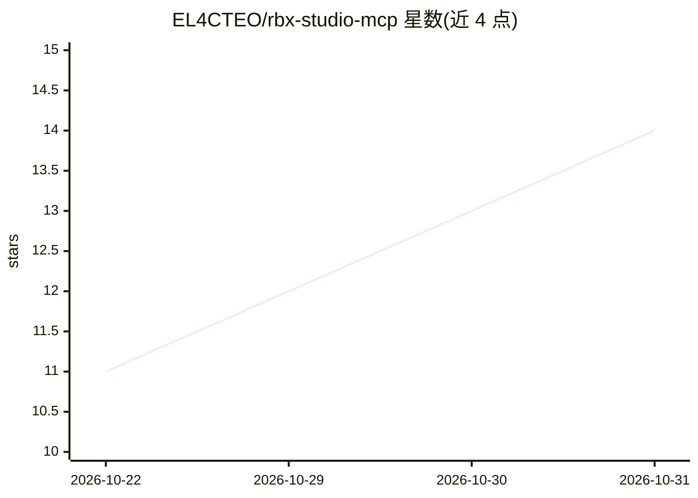

# EL4CTEO/rbx-studio-mcp

⭐ 14 · Luau · MIT · 推送 2026-10-28 · [GitHub](https://github.com/EL4CTEO/rbx-studio-mcp) · [官网](https://www.npmjs.com/package/@el4cteo/rbx-studio-mcp) · 个人维护

**让 AI agent 操作 Roblox Studio 的 MCP 服务器（35 个工具）**

面向 Roblox 开发者的 MCP 服务器：通过 Studio 插件 + 本地回环服务器（端口 44755）让 Claude Code、Codex、Cursor 等 31 种 coding agent 读取场景、编辑脚本、构建几何、运行 playtest、截图与调试。写入工具接受数组并经脚本编辑器落地，保证可撤销与原子性；`sync` 将脚本镜像到磁盘文件夹供 agent 用文件工具编辑，双向同步并处理冲突。部分 Open Cloud 调用（资产上传、线上数据、发布场景执行 Luau）需 Roblox API key。安装经 npx 完成，MIT 许可。

## 筛选速览

| 维度 | 判定 | 备注 |
|---|---|---|
| AI 角色 | `ai-ecosystem` | LLM/agent 周边工具 |
| 许可风险 | `permissive` | MIT |
| 部署形态 | `library` | 以包/库形式分发 |
| 模型依赖 | — | README 未给出锁定关系 |
| 硬件要求 | — | 无带数字的原话,不猜 |
| 安装摩擦 | `low` | 无编译、无系统依赖或容器化 |
| 成熟度 | — | 结构信号不足 |

## 能力要点

- 35 个工具覆盖脚本编辑、实例操作、地形几何、playtest、截图与 Open Cloud
- 写入工具数组化批量提交，经脚本编辑器保证安全编辑与一次性撤销
- `sync` 双向镜像脚本到磁盘（Rojo 风格布局），支持冲突检测与 `.build.json` 导出重建
- Studio 内控制台可调用 31 种 coding agent 以对话驱动开发

## 适用场景

- 用 Claude Code 或 Codex 等 agent 直接在 Roblox Studio 中写与改脚本
- 让 agent 运行 playtest、检查客户端状态与碰撞并截图验证
- 把 Studio 脚本同步到文件夹，用 agent 的文件工具编辑后回推测试
- 经 Open Cloud 上传资产或操作线上场景数据

## 场景标签

`编码 Agent` · 领域:编码与开发

## 证据(README 行号)

> L3: Let an AI agent drive Roblox Studio: read your place, edit scripts, build geometry, run playtests, take screenshots.
> L20: claude mcp add roblox-studio -- npx -y @el4cteo/rbx-studio-mcp
> L152: **With `chat on`, prompts start a real agent**, using whichever of 31 supported agents you have on PATH: Claude Co

## 星数曲线

2026-10-22 11 → 2026-10-31 14（+3）

---
*卡片 v1 · prompt 1.4 · 生成 2026-10-31 · 置信度 high · 依据 README sha `967122861d35` · [字段定义](../../DATASET.md)*
