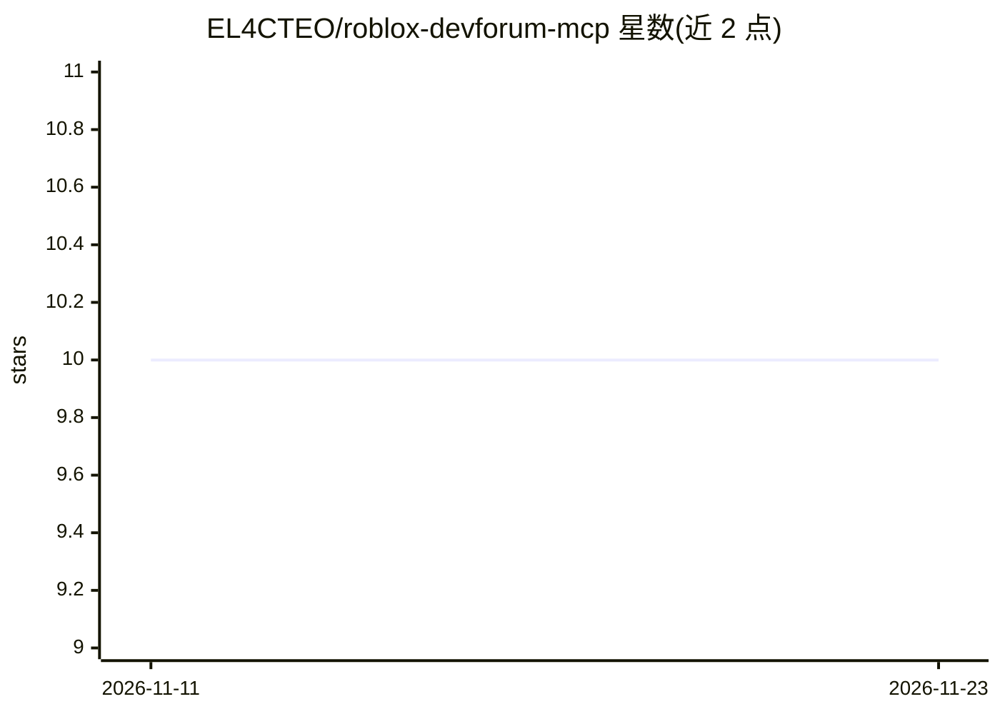

# EL4CTEO/roblox-devforum-mcp

⭐ 10 · Rust · MIT · 推送 2026-11-21 · [GitHub](https://github.com/EL4CTEO/roblox-devforum-mcp) · [官网](https://www.npmjs.com/package/roblox-devforum-mcp) · 个人维护

**给 AI 编码代理接入 Roblox DevForum 与官方文档的 MCP 服务器**

以 MCP 服务器形式向 AI 编码代理提供 Roblox 开发者论坛与官方 creator docs 的只读检索能力：支持论坛/ bug 分类搜索、读取主题与已采纳答案、按内容检索文档页、查询引擎 API 签名与弃用状态、检查 API 健康度等 10 个工具，全部返回带来源 URL 的 Markdown 并受 token 预算约束。Rust 编写的原生二进制，无需 API key 与登录，支持 Claude CLI、DeepSeek Harness 及任意 MCP 客户端接入。

## 筛选速览

| 维度 | 判定 | 备注 |
|---|---|---|
| AI 角色 | `ai-ecosystem` | LLM/agent 周边工具 |
| 许可风险 | `permissive` | MIT |
| 部署形态 | `library` | 以包/库形式分发 |
| 模型依赖 | locked-api |  |
| 硬件要求 | — | 无带数字的原话,不猜 |
| 安装摩擦 | `medium` | 含编译或系统依赖之一 |
| 成熟度 | — | 结构信号不足 |

## 能力要点

- 10 个只读工具：论坛搜索、bug 检索、线程阅读、文档检索、API 健康检查等
- 无需 API key、登录或设置，Rust 原生二进制约 6 MB 内存
- 支持 Claude CLI、DeepSeek Harness 及任意 MCP 客户端
- 缓存 TTL、超时、重试、并发均可通过环境变量配置

## 适用场景

- 编码时核查 Roblox bug 是否已知并读取采纳答案
- 编写 Luau 前验证引擎 API 签名与弃用状态
- 搜索官方 creator docs 页面内容

## 场景标签

`编码 Agent` · 领域:编码与开发

## 证据(README 行号)

> L5: An MCP server that gives an AI coding agent the **Roblox

## 星数曲线

2026-11-11 10 → 2026-11-23 10（+0）

---
*卡片 v1 · prompt 1.4 · 生成 2026-11-20 · 置信度 high · 依据 README sha `e2de3ac67c6c` · [字段定义](../../DATASET.md)*
