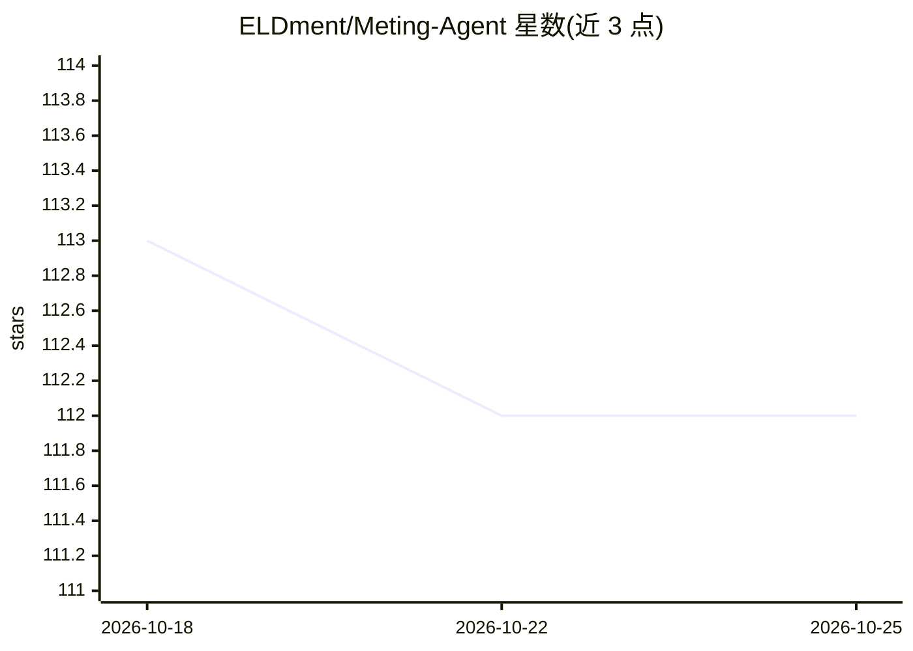

# ELDment/Meting-Agent

⭐ 112 · JavaScript · MIT · 推送 2026-03-20 · [GitHub](https://github.com/ELDment/Meting-Agent) · [官网](https://www.npmjs.com/package/@eldment/meting-agent) · 个人维护 · 中文 README

**面向 AI 的多平台音乐 API 封装（MCP 服务与 Skill）**

基于 metowolf/Meting 构建的多平台音乐能力封装，提供 MCP 服务与 Skill 两种交付物。统一接口包含 search、song、album、artist、playlist、url、lyric、pic 八个方法，覆盖歌曲搜索、详情查询、播放链接获取与歌词/封面读取。支持网易云音乐、腾讯音乐、酷狗音乐、酷我音乐四个平台，供 AI agent 通过 Model Context Protocol 或 Skill 配置接入音乐能力。MCP 与 Skill 的配置说明分别见对应子目录文档。

## 筛选速览

| 维度 | 判定 | 备注 |
|---|---|---|
| AI 角色 | `ai-ecosystem` | LLM/agent 周边工具 |
| 许可风险 | `permissive` | MIT |
| 部署形态 | `None` |  |
| 模型依赖 | — | README 未给出锁定关系 |
| 硬件要求 | — | 无带数字的原话,不猜 |
| 安装摩擦 | `low` | 无编译、无系统依赖或容器化 |
| 成熟度 | — | 结构信号不足 |

## 能力要点

- 提供 MCP 与 Skill 两种交付物
- 统一接口含 search/song/album/artist/playlist/url/lyric/pic 八个方法
- 支持网易云音乐、腾讯音乐、酷狗、酷我四个平台

## 适用场景

- 为 MCP 客户端的 AI agent 接入多平台音乐搜索与播放能力
- 通过 Skill 配置让 AI 读取歌词、封面与歌单信息
- 跨平台统一调用音乐数据接口

## 场景标签

 · 领域:AI 工具/音乐服务接口

## 证据(README 行号)

> L5: `Meting-Agent` 是基于 **metowolf/Meting** 构建的多平台音乐能力封装，当前提供两类交付物：
> L7: - **MCP**：@eldment/meting-agent

## 星数曲线

2026-10-18 113 → 2026-10-25 112（-1）

---
*卡片 v1 · prompt 1.4 · 生成 2026-10-23 · 置信度 high · 依据 README sha `a448bb5abc19` · [字段定义](../../DATASET.md)*
