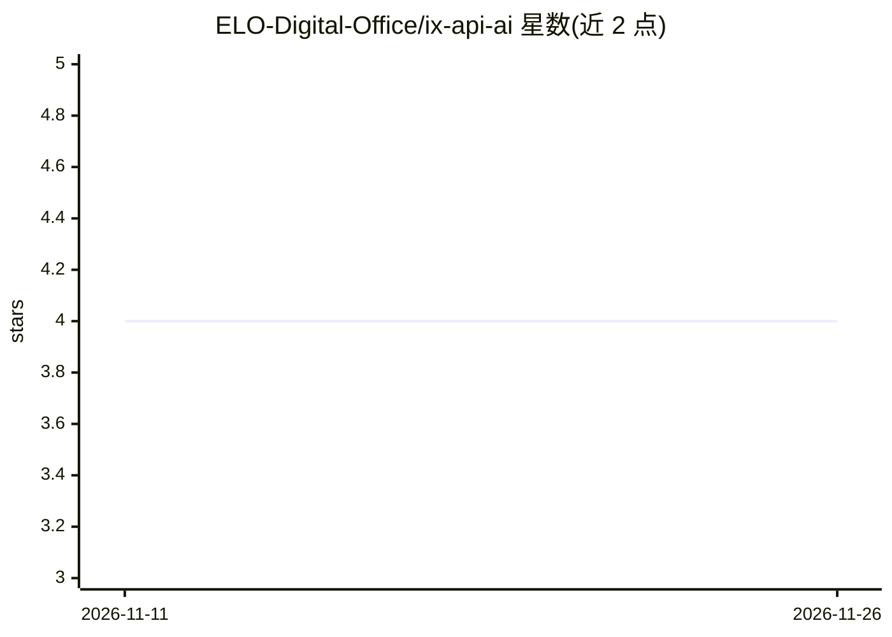

# ELO-Digital-Office/ix-api-ai

⭐ 4 · Python · MIT · 推送 2026-11-20 · [GitHub](https://github.com/ELO-Digital-Office/ix-api-ai) · 组织维护

**面向 AI 编码代理的 ELO Indexserver REST API 文档与示例集**

提供 ELO Indexserver REST API 的文档、OpenAPI 规范（v25.0.1.5）、任务指南与 JavaScript 示例（浏览器/Node.js），供开发者构建或排障与 ELO 仓库通信的应用。内置 agent skill（SKILL.md）供 AI 编码代理在写代码前加载，涵盖认证、文档、元数据、搜索、工作流等任务；附文档生成与校验脚本及 Copilot 指令。不含 SOAP 遗留 API、产品 UI 开发与绕过 Indexserver 的数据库访问。

## 筛选速览

| 维度 | 判定 | 备注 |
|---|---|---|
| AI 角色 | `ai-knowledge` | 知识聚合/清单类 |
| 许可风险 | `permissive` | MIT |
| 部署形态 | `None` |  |
| 模型依赖 | — | README 未给出锁定关系 |
| 硬件要求 | — | 无带数字的原话,不猜 |
| 安装摩擦 | `low` | 无编译、无系统依赖或容器化 |
| 成熟度 | — | 结构信号不足 |

## 能力要点

- 含 OpenAPI v25.0.1.5 定义与生成的操作/模式参考
- 提供 agent skill（SKILL.md）供 AI 编码代理加载
- JavaScript 示例覆盖认证、文档上传、元数据、搜索、工作流
- 提供文档再生成与技能/示例校验脚本

## 适用场景

- 让 AI 编码代理按 SKILL.md 规则编写 ELO 集成代码
- 为访问 ELO 仓库的应用查找 REST 调用示例
- 排查 Gen1/Gen2 元数据、分页搜索等常见错误

## 场景标签

`编码 Agent` `代码生成` · 领域:编码与开发

## 证据(README 行号)

> L19: AI coding agents: load the skill
> L33: |skills/elo-indexserver-rest/|Agent skill: core rules and compact task references (authentication, documents, metad

## 星数曲线

2026-11-11 4 → 2026-11-26 4（+0）

---
*卡片 v1 · prompt 1.4 · 生成 2026-11-21 · 置信度 high · 依据 README sha `cc0c844e68ad` · [字段定义](../../DATASET.md)*
