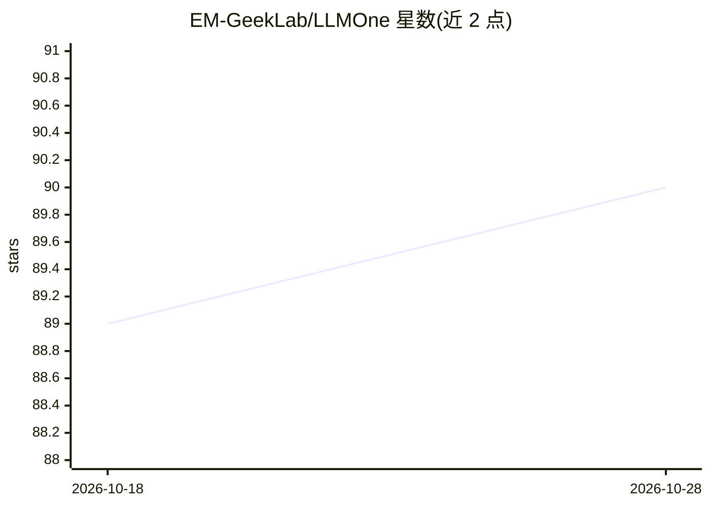

# EM-GeekLab/LLMOne

⭐ 90 · TypeScript · MulanPSL-2.0 · 推送 2026-09-21 · [GitHub](https://github.com/EM-GeekLab/LLMOne) · 组织维护 · 中文 README

**企业级大模型私有化部署平台：全栈自动化交付推理服务**

面向企业、一体机厂商与高性能设备用户的 LLM 部署与服务平台，将操作系统、驱动到模型服务的全栈部署流程自动化，通过 BMC（iDRAC/iLO/iBMC 等）对目标硬件执行远程装系统、挂载镜像等底层操作，小时级完成部署。集成 vLLM 等推理引擎，支持 NVIDIA GPU、Ascend NPU、Apple Silicon 及其他国产芯片；提供模型管理、部署报告、性能测试与可视化监控，可集成 OpenWebUI、Dify、RAGFlow 等应用。客户端以 Windows 便携版 exe 与 macOS DMG 提供。

## 筛选速览

| 维度 | 判定 | 备注 |
|---|---|---|
| AI 角色 | `ai-ecosystem` | LLM/agent 周边工具 |
| 许可风险 | `viral` | MulanPSL-2.0 |
| 部署形态 | `desktop` | 安装包/桌面程序 |
| 模型依赖 | local-ok | 支持本地模型 |
| 硬件要求 | — | 无带数字的原话,不猜 |
| 安装摩擦 | `low` | 无编译、无系统依赖或容器化 |
| 成熟度 | — | 结构信号不足 |

## 能力要点

- 从操作系统到模型服务的全栈自动化部署，通过 BMC 远程操作目标硬件
- 集成 vLLM 等推理引擎，支持 NVIDIA GPU / Ascend NPU / Apple Silicon / 国产芯片
- 部署报告与内置性能测试，可视化运维监控界面
- 支持集成 OpenWebUI、Dify、RAGFlow 等应用生态

## 适用场景

- 在私有硬件上一键部署大模型推理服务，替代手工配置流程
- 一体机厂商为产品预装大模型服务，缩短交付周期
- 技术团队在自有 DGX 级服务器或 Mac Studio 上搭建推理平台

## 场景标签

`推理引擎` `MLOps` · 领域:训练与推理

## 证据(README 行号)

> L21: LLMOne 是一款开源、轻量的 **企业级大语言模型部署与服务平台**。它致力于解决传统大模型私有化部署中周期长、配置复杂、性能难以保障、运维成本高等痛点。
> L54: - **极速自动化部署：** 全栈自动化，小时级完成从系统到模型的部署，真正实现“开箱即用”。
> L55: - **专业级推理性能：** 集成 vLLM 等领先推理引擎，深度优化主流 AI 硬件，保障企业级性能与高可靠性。

## 星数曲线

2026-10-18 89 → 2026-10-28 90（+1）

---
*卡片 v1 · prompt 1.4 · 生成 2026-10-23 · 置信度 high · 依据 README sha `aa65054501d3` · [字段定义](../../DATASET.md)*
