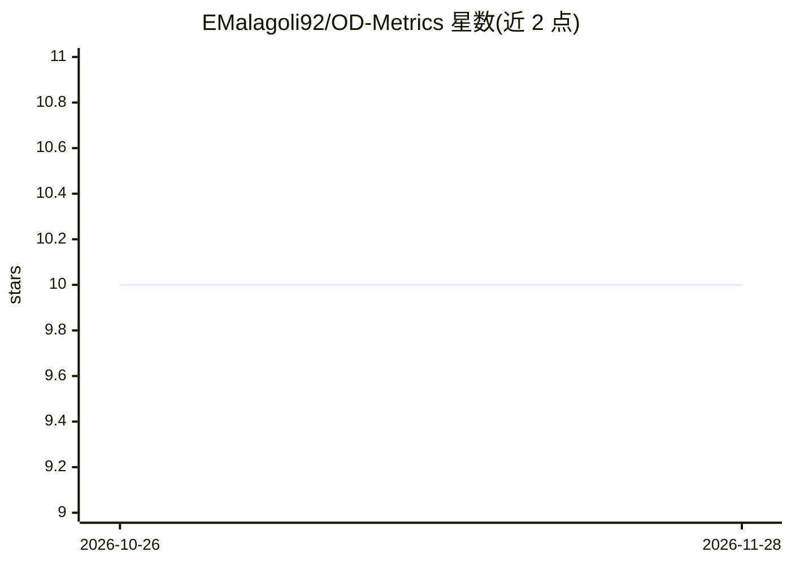

# EMalagoli92/OD-Metrics

⭐ 10 · Python · Apache-2.0 · 推送 2026-02-16 · [GitHub](https://github.com/EMalagoli92/OD-Metrics) · [官网](https://emalagoli92.github.io/OD-Metrics/) · 个人维护

**目标检测评估指标的 Python 库：计算 mAP/mAR/IoU**

用于计算目标检测评估指标的 Python 库，支持 mAP（平均精度均值）、mAR（平均召回率均值）与 IoU 三类指标，每个指标定义中的参数均可自定义设置。库经过与 COCOAPI 的兼容性测试以保证结果一致性。通过 PyPI 或 GitHub 仓库以 pip 安装，提供文档、API 参考与指标公式说明，并在 Binder 与 Google Colab 上提供可在线运行的示例笔记本，附简单使用示例代码。

## 筛选速览

| 维度 | 判定 | 备注 |
|---|---|---|
| AI 角色 | `ai-ecosystem` | LLM/agent 周边工具 |
| 许可风险 | `permissive` | Apache-2.0 |
| 部署形态 | `library` | 以包/库形式分发 |
| 模型依赖 | — | README 未给出锁定关系 |
| 硬件要求 | — | 无带数字的原话,不猜 |
| 安装摩擦 | `low` | 无编译、无系统依赖或容器化 |
| 成熟度 | — | 结构信号不足 |

## 能力要点

- 支持 mAP、mAR、IoU 三类目标检测指标计算
- 指标定义中每个参数均可自定义取值
- 经测试与 COCOAPI 兼容
- 提供 Binder 与 Google Colab 在线示例笔记本

## 适用场景

- 评估自己训练的目标检测模型的精度与召回
- 在不引入完整 COCOAPI 的情况下计算检测指标
- 在线笔记本中快速试用检测指标计算

## 场景标签

 · 领域:计算机视觉/模型评估

## 证据(README 行号)

> L13:  A python library for Object Detection metrics.
> L18: - **COCOAPI Compatibility**: Metrics are rigorously tested to ensure compatibility with COCOAPI, ensuring reliabili
> L20: ## Supported Metrics

## 星数曲线

2026-10-26 10 → 2026-11-28 10（+0）

---
*卡片 v1 · prompt 1.4 · 生成 2026-11-20 · 置信度 high · 依据 README sha `88c51c9840d7` · [字段定义](../../DATASET.md)*
