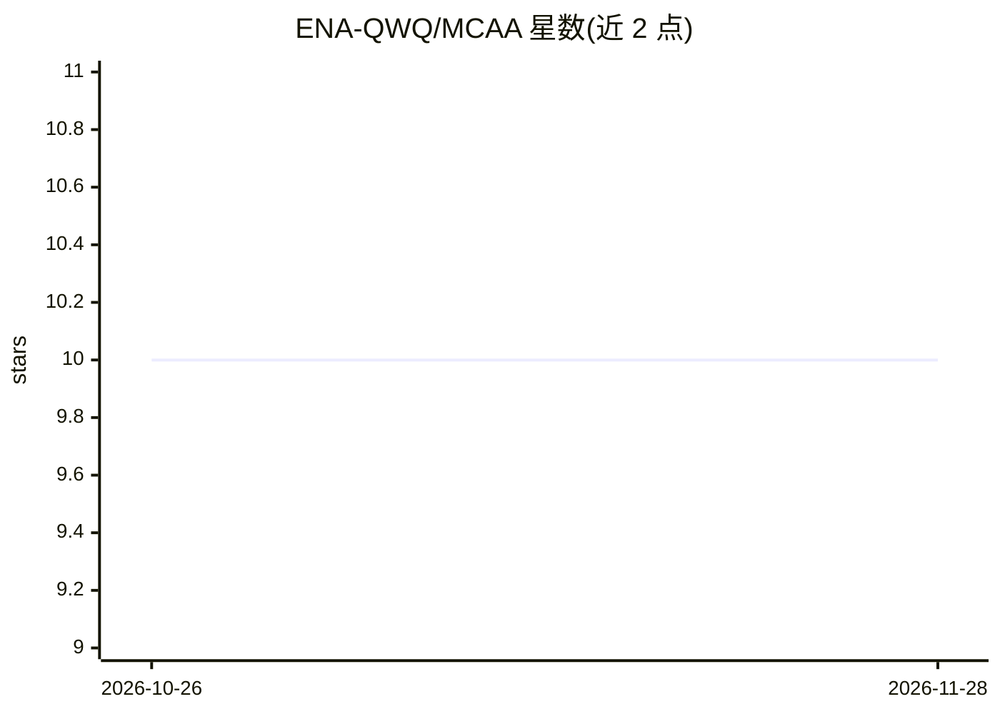

# ENA-QWQ/MCAA

⭐ 10 · Java · MIT · 推送 2026-04-12 · [GitHub](https://github.com/ENA-QWQ/MCAA) · 个人维护 · 中文 README

**将 LLM Agent 集成到 Minecraft 的 Fabric 模组**

MCAA 是一个 Fabric 模组，通过多 Agent 协作架构将大语言模型接入 Minecraft：Master Agent 理解玩家意图并协调 Commander/Builder/Scout 等子 Agent，提供扫描方块、寻路、截图、建造结构、执行命令与 JavaScript 脚本等 15 类工具，内置 Rhino 沙箱脚本引擎与 Minecraft 知识库。通过 Web UI（localhost:9178）配置 OpenAI 兼容的 LLM API，支持关键词触发与断路器保护。前置要求 Minecraft 1.21.11、Fabric Loader 0.18.4+、Java 21+。作者声明不再主动维护。

## 筛选速览

| 维度 | 判定 | 备注 |
|---|---|---|
| AI 角色 | `ai-enhanced` | 去掉 AI 部分产品仍成立 |
| 许可风险 | `permissive` | MIT |
| 部署形态 | `None` |  |
| 模型依赖 | local-ok | 支持本地模型 |
| 硬件要求 | — | 无带数字的原话,不猜 |
| 安装摩擦 | `medium` | 含编译或系统依赖之一 |
| 成熟度 | `idea` | |

## 能力要点

- 多 Agent 架构：Master/Commander/Builder/Scout 协作分工
- 15 类游戏内工具（扫描/寻路/建造/脚本执行等）
- 内置 Mozilla Rhino JavaScript 沙箱引擎
- OpenAI 兼容接口，支持配置本地 Ollama 等端点

## 适用场景

- 在 Minecraft 中让 AI 帮忙自主建造结构
- 通过对话与关键词触发让 AI 执行游戏任务
- 以 JavaScript 脚本扩展游戏内自动化操作

## 场景标签

`多智能体` · 领域:Agent 开发

## 证据(README 行号)

> L15: MCAA (Minecraft AI Agent) 是一个 Fabric 模组，将大语言模型 (LLM) 的强大能力带入 Minecraft 世界。通过多 Agent 协作架构，AI 可以理解游戏环境、执行复杂任务、与玩家对话，甚
> L7: 将 AI Agent 智能集成到 Minecraft 中 - 通过大语言模型让 AI 理解游戏世界、执行任务、与玩家对话、自主建造。
> L58: - 支持多种 LLM API（OpenAI 兼容接口）

## 星数曲线

2026-10-26 10 → 2026-11-28 10（+0）

---
*卡片 v1 · prompt 1.4 · 生成 2026-11-20 · 置信度 high · 依据 README sha `34ed51c6e07d` · [字段定义](../../DATASET.md)*
