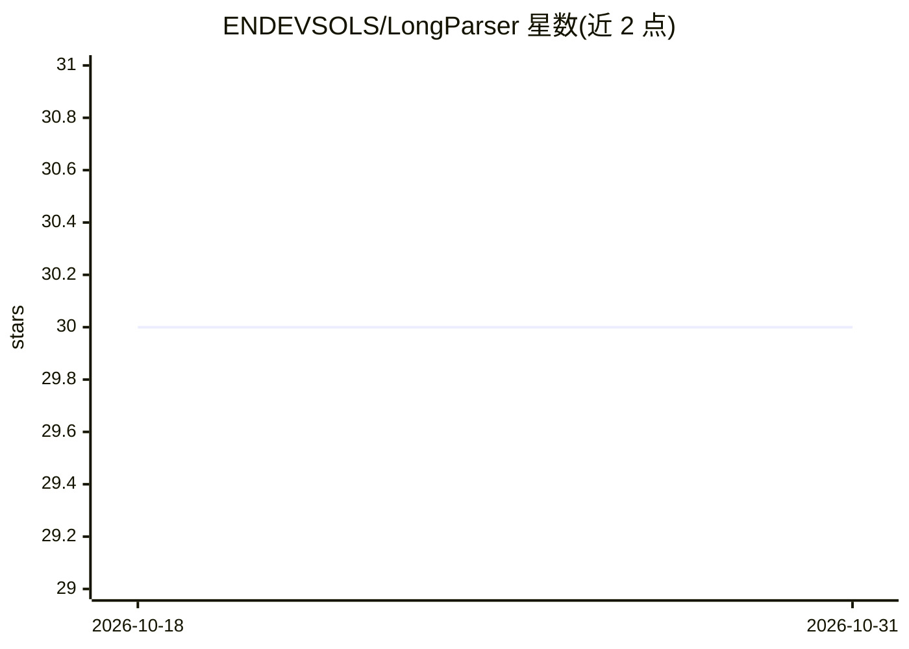

# ENDEVSOLS/LongParser

⭐ 30 · Python · NOASSERTION · 推送 2026-10-23 · [GitHub](https://github.com/ENDEVSOLS/LongParser) · [官网](https://endevsols.com/open-source/longparser) · 组织维护

**面向 RAG 管线的隐私优先文档解析引擎**

文档解析与分块引擎：通过 Docling/Marker 提取 PDF、DOCX、PPTX、XLSX、CSV，生成 token/标题层级/表格感知的混合分块，辅以语义分块、跨引用链接、质量评分与 Regex+NER 的 PII 脱敏。含人工介入（HITL）审核工作流（LangGraph interrupt + MongoDB checkpointer）、3 层记忆对话与 FastAPI+MongoDB+Redis 生产服务器。所有处理本地运行，声明数据不离本机。以 pip 包（含多种 extras）与 Docker Compose 形式提供。

## 筛选速览

| 维度 | 判定 | 备注 |
|---|---|---|
| AI 角色 | `ai-ecosystem` | LLM/agent 周边工具 |
| 许可风险 | `none` | NOASSERTION |
| 部署形态 | `self-host` | docker 或自建部署 |
| 模型依赖 | locked-api |  |
| 硬件要求 | — | 无带数字的原话,不猜 |
| 安装摩擦 | `low` | 无编译、无系统依赖或容器化 |
| 成熟度 | — | 结构信号不足 |

## 能力要点

- Docling/Marker 多格式提取与 token/标题/表格感知的混合分块
- LangGraph interrupt 的 HITL 块/分块审核工作流（approve/edit/reject）
- 3 层记忆对话（短期轮次+滚动摘要+长期事实）与多 LLM 供应商支持
- 全本地处理的隐私声明与租户隔离/RBAC

## 适用场景

- 把 PDF/Office 文档解析成 RAG 管线可用的分块
- 在向量化前人工审核和修订解析结果
- 私有化部署带 API 与队列的生产文档处理服务

## 场景标签

`文档解析` · 领域:知识与检索

## 证据(README 行号)

> L4:  Parse PDFs, DOCX, PPTX, XLSX & CSV → validated, AI-ready chunks with HITL review.
> L127: Document → Extract → Validate → HITL Review → Chunk → Embed → Index

## 星数曲线

2026-10-18 30 → 2026-10-31 30（+0）

---
*卡片 v1 · prompt 1.4 · 生成 2026-10-26 · 置信度 high · 依据 README sha `9bb32f98eac7` · [字段定义](../../DATASET.md)*
