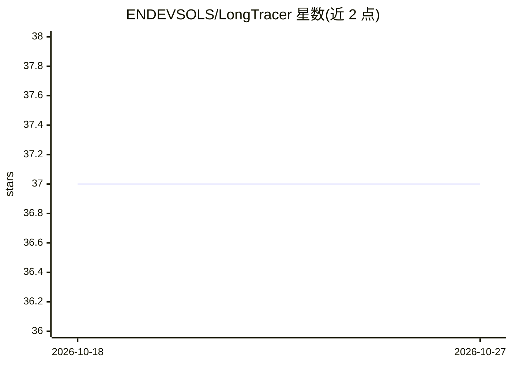

# ENDEVSOLS/LongTracer

⭐ 37 · Python · MIT · 推送 2026-10-22 · [GitHub](https://github.com/ENDEVSOLS/LongTracer) · [官网](https://endevsols.com/open-source/longtracer) · 组织维护

**检测 LLM 回答幻觉的验证与追踪库：逐条声明对照来源核验**

面向 RAG 应用的 Python 幻觉检测与追踪 SDK：将 LLM 回答拆分为声明句，用 STS 双编码器（all-MiniLM-L6-v2）匹配来源句子，再用 NLI 交叉编码器（nli-deberta-v3-xsmall）判定蕴含/矛盾/中立，输出信任分与幻觉标记；核心不依赖向量库和 LLM 提供方，只接收字符串。提供 LangChain/LlamaIndex/Haystack/LangGraph 适配器、CLI、内置 Web Dashboard、多项目追踪（SQLite/Memory/Mongo/Postgres/Redis 后端）、OpenTelemetry 导出与告警通知。要求 Python 3.11+。

## 筛选速览

| 维度 | 判定 | 备注 |
|---|---|---|
| AI 角色 | `ai-ecosystem` | LLM/agent 周边工具 |
| 许可风险 | `permissive` | MIT |
| 部署形态 | `library` | 以包/库形式分发 |
| 模型依赖 | local-ok | 支持本地模型 |
| 硬件要求 | — | 无带数字的原话,不猜 |
| 安装摩擦 | `low` | 无编译、无系统依赖或容器化 |
| 成熟度 | — | 结构信号不足 |

## 能力要点

- STS + NLI 混合核验，无需 LLM 调用与向量库
- LangChain/LlamaIndex/Haystack/LangGraph 框架适配器，3 行接入自动验证
- 内置 Web Dashboard 与多项目追踪，支持 5 种存储后端
- OpenTelemetry 导出（兼容 Jaeger/Datadog/Grafana Tempo）与信任分阈值告警

## 适用场景

- RAG 上线后自动核验每条回答是否有来源支撑
- 在 LangChain/LlamaIndex/Haystack 管线中接入幻觉检测
- 多项目追踪幻觉率并通过 Webhook/Slack 告警

## 场景标签

`LLM 可观测性` · 领域:评测与运维

## 证据(README 行号)

> L18: Detect hallucinations in LLM-generated responses. LongTracer verifies every claim against source documents using hy
> L88: 1. **Claim splitting** — LLM response is split into individual sentences/claims
> L106: # Your chain.invoke() now auto-verifies every response

## 星数曲线

2026-10-18 37 → 2026-10-27 37（+0）

---
*卡片 v1 · prompt 1.4 · 生成 2026-10-25 · 置信度 high · 依据 README sha `857555c88ef2` · [字段定义](../../DATASET.md)*
