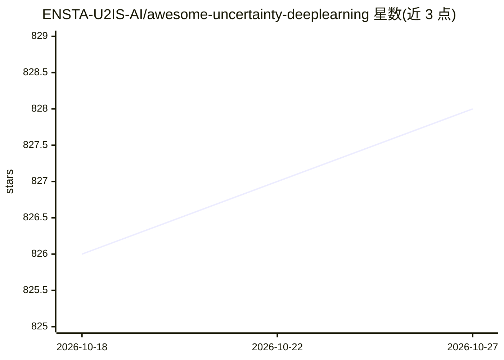

# ENSTA-U2IS-AI/awesome-uncertainty-deeplearning

⭐ 828 · MIT · 推送 2026-10-20 · [GitHub](https://github.com/ENSTA-U2IS-AI/awesome-uncertainty-deeplearning) · 组织维护

**深度学习不确定性估计的论文与代码策展清单**

由 ENSTA-U2IS-AI 实验室维护的 awesome 类资源清单，收录深度学习预测不确定性估计方向的综述、理论论文、贝叶斯方法论文及配套代码，按 Survey/Theory/Bayesian-Methods 等类别组织，条目标注会议/期刊出处（NeurIPS、ICLR、ICML、JMLR 等）并附 arXiv 与 GitHub 链接；部分条目链接到维护方自身的 TorchUncertainty 库。通过 PR 与 GitHub discussion 接受补充。

## 筛选速览

| 维度 | 判定 | 备注 |
|---|---|---|
| AI 角色 | `ai-knowledge` | 知识聚合/清单类 |
| 许可风险 | `permissive` | MIT |
| 部署形态 | `None` |  |
| 模型依赖 | — | README 未给出锁定关系 |
| 硬件要求 | — | 无带数字的原话,不猜 |
| 安装摩擦 | `medium` | 含编译或系统依赖之一 |
| 成熟度 | — | 结构信号不足 |

## 能力要点

- 按综述/理论/贝叶斯方法分类组织条目
- 条目标注会议或期刊出处并附 arXiv/GitHub 链接
- 覆盖 NeurIPS/ICLR/ICML/JMLR/TMLR 等会议期刊
- 接受社区通过 pull request 补充条目

## 适用场景

- 查找不确定性估计方向的综述论文入门
- 为研究选题检索贝叶斯深度学习论文与开源代码
- 按会议/期刊定位特定方法的实现仓库

## 场景标签

`精选清单` · 领域:学习与行业

## 证据(README 行号)

> L6: This repo is a collection of *awesome* papers, codes, books, and blogs about Uncertainty and Deep learning.
> L20: ## Surveys
> L84: ## Bayesian-Methods

## 星数曲线

2026-10-18 826 → 2026-10-27 828（+2）

---
*卡片 v1 · prompt 1.4 · 生成 2026-10-21 · 置信度 high · 依据 README sha `d188747b24bc` · [字段定义](../../DATASET.md)*
