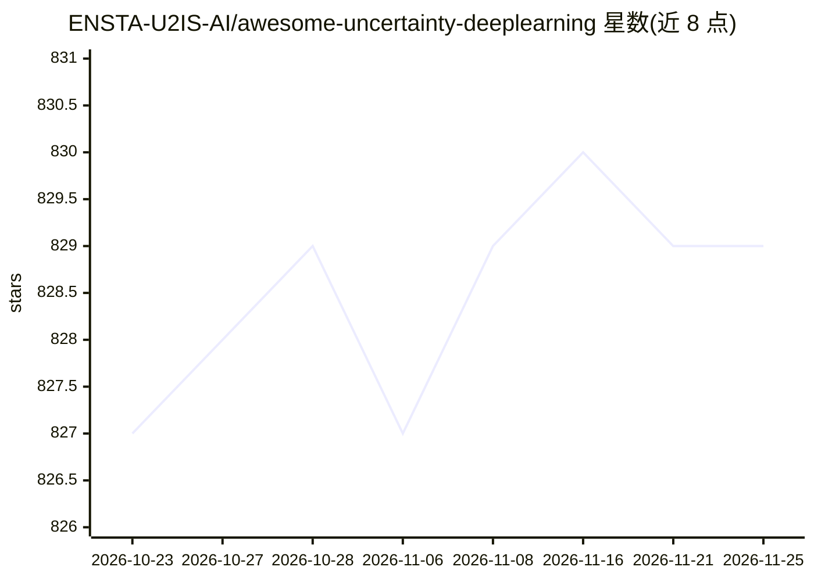

# ENSTA-U2IS-AI/awesome-uncertainty-deeplearning

⭐ 829 · MIT · 推送 2026-10-20 · [GitHub](https://github.com/ENSTA-U2IS-AI/awesome-uncertainty-deeplearning) · 组织维护

**深度学习不确定性估计的论文/代码/数据集策展清单**

以 Awesome 清单形式收录深度学习模型预测不确定性估计相关的综述、论文、代码、书籍与博客，按 Surveys、Theory、Bayesian-Methods 等章节组织，条目标注发表会议/期刊/年份并附 arXiv 与 GitHub 链接，部分条目提供 PyTorch/TensorFlow 实现。面向研究该方向的研究者与工程师做文献检索入口，接受社区通过 pull request 与 GitHub discussion 补充条目。仓库本身不提供可运行的软件，无安装或运行说明。

## 筛选速览

| 维度 | 判定 | 备注 |
|---|---|---|
| AI 角色 | `ai-knowledge` | 知识聚合/清单类 |
| 许可风险 | `permissive` | MIT |
| 部署形态 | `None` |  |
| 模型依赖 | — | README 未给出锁定关系 |
| 硬件要求 | — | 无带数字的原话,不猜 |
| 安装摩擦 | `medium` | 含编译或系统依赖之一 |
| 成熟度 | — | 结构信号不足 |

## 能力要点

- 按综述、理论、贝叶斯方法等章节分类组织论文条目
- 部分条目附 PyTorch/TensorFlow 代码仓库链接
- 标注会议/期刊与年份，附 arXiv 链接
- 接受社区 PR 与 discussion 补充条目

## 适用场景

- 查找不确定性估计方向的综述与经典论文
- 按方法类别检索配套开源实现
- 调研贝叶斯深度学习研究脉络

## 场景标签

`精选清单` · 领域:学习与行业

## 证据(README 行号)

> L6: This repo is a collection of *awesome* papers, codes, books, and blogs about Uncertainty and Deep learning.
> L18: # Papers
> L20: ## Surveys

## 星数曲线

2026-10-23 827 → 2026-11-25 829（+2）

---
*卡片 v1 · prompt 1.4 · 生成 2026-11-24 · 置信度 high · 依据 README sha `8d8cd795fbe1` · [字段定义](../../DATASET.md)*
