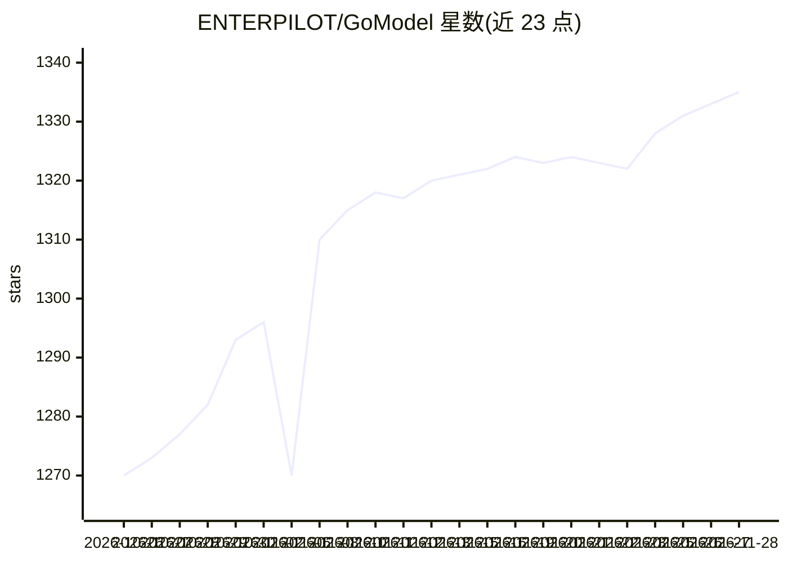

# ENTERPILOT/GoModel

⭐ 1,335 · Go · MIT · 推送 2026-11-27 · [GitHub](https://github.com/ENTERPILOT/GoModel) · [官网](https://gomodel.enterpilot.io/?utm_source=github_desc) · 组织维护

**Go 编写的 AI 网关：统一多家 LLM 的接入、路由与成本追踪**

用 Go 编写的 AI 网关/代理：在 `/v1` 与 `/v1/messages` 暴露 OpenAI 与 Anthropic 兼容 API，官方 SDK 改 base URL 即可使用。网关层提供缓存、按请求成本追踪与预算、速率限制、虚拟模型负载均衡、会话粘滞、故障转移重试、守卫策略、MCP 聚合、Prometheus/OpenTelemetry 可观测性与仪表盘。配置支持 config.yaml、.env 与环境变量分层覆盖。另含商业版 GoModel Pro，提供提示压缩、智能路由与 OIDC 单点登录扩展。

## 筛选速览

| 维度 | 判定 | 备注 |
|---|---|---|
| AI 角色 | `ai-ecosystem` | LLM/agent 周边工具 |
| 许可风险 | `permissive` | MIT |
| 部署形态 | `self-host` | docker 或自建部署 |
| 模型依赖 | local-ok | 支持本地模型 |
| 硬件要求 | — | 无带数字的原话,不猜 |
| 安装摩擦 | `low` | 无编译、无系统依赖或容器化 |
| 成熟度 | — | 结构信号不足 |

## 能力要点

- OpenAI/Anthropic 兼容端点，官方 SDK 无需改动即接入
- 缓存、预算、速率限制、failover、虚拟模型等网关功能
- Prometheus 指标、OpenTelemetry 追踪与请求日志仪表盘
- MCP gateway 聚合与 Passthrough 原生 API 透传

## 适用场景

- 统一接入多家 LLM 并在一个仪表盘查看用量与花费
- 为团队/API key 设置预算与速率限制
- 多 provider 间做自动故障转移与负载均衡

## 场景标签

`模型网关` `LLM 可观测性` · 领域:Agent 开发

## 证据(README 行号)

> L17:  GoModel is the fastest and the most resource-efficient AI Gateway (the self-reproducible benchmarks). It's an alte
> L84: - OpenAI-compatible at `/v1`
> L165: - Caching - exact and semantic response caching, so repeated prompts cost nothing

## 星数曲线

2026-10-26 1,270 → 2026-11-28 1,335（+65）

---
*卡片 v1 · prompt 1.4 · 生成 2026-11-24 · 置信度 mid · 依据 README sha `7b39e84f83d3` · [字段定义](../../DATASET.md)*
