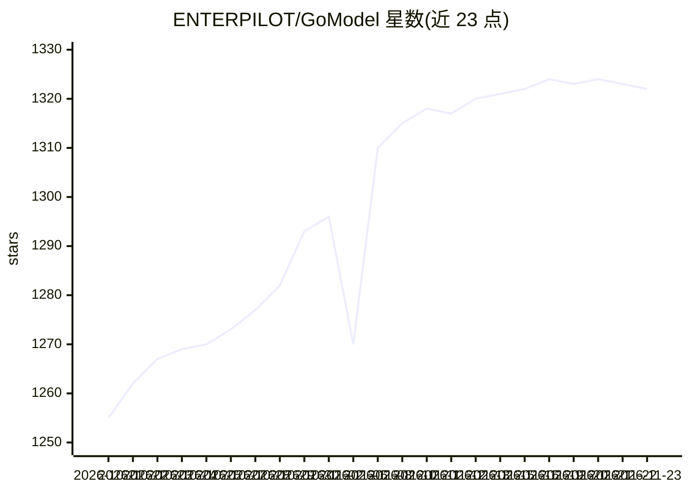

# ENTERPILOT/GoModel

⭐ 1,322 · Go · MIT · 推送 2026-11-21 · [GitHub](https://github.com/ENTERPILOT/GoModel) · [官网](https://gomodel.enterpilot.io/?utm_source=github_desc) · 组织维护

**Go 编写的 AI 网关：统一多家 LLM 的 API 接入**

用 Go 编写的 AI 网关/控制平面，提供 OpenAI 兼容（/v1）与 Anthropic 兼容（/v1/messages）两类端点，官方 SDK 无需改动即可接入。功能覆盖响应缓存、成本跟踪、预算与限流、虚拟模型负载均衡、会话粘滞、故障转移、护栏、插件、MCP 聚合网关，以及 Prometheus/OpenTelemetry 可观测性。通过 Docker、macOS/Linux/Windows 安装脚本部署，带管理仪表盘。另有商业版 GoModel Pro 提供提示压缩、智能路由与 OIDC 单点登录。

## 筛选速览

| 维度 | 判定 | 备注 |
|---|---|---|
| AI 角色 | `ai-ecosystem` | LLM/agent 周边工具 |
| 许可风险 | `permissive` | MIT |
| 部署形态 | `self-host` | docker 或自建部署 |
| 模型依赖 | local-ok | 支持本地模型 |
| 硬件要求 | — | 无带数字的原话,不猜 |
| 安装摩擦 | `low` | 无编译、无系统依赖或容器化 |
| 成熟度 | — | 结构信号不足 |

## 能力要点

- OpenAI 与 Anthropic 双兼容 API，官方 SDK 直接对接
- 缓存、预算、限流、故障转移与智能路由等网关能力
- Prometheus 指标、OpenTelemetry 追踪与仪表盘可观测性
- MCP 聚合网关与插件机制

## 适用场景

- 为团队统一接入多家 LLM 提供商并跟踪成本
- 通过缓存与路由降低推理支出
- 为应用提供稳定的 OpenAI 兼容端点与故障转移

## 场景标签

`模型网关` · 领域:Agent 开发

## 证据(README 行号)

> L17:  GoModel is the fastest and the most resource-efficient AI Gateway (the self-reproducible benchmarks). It's an alte
> L84: - OpenAI-compatible at `/v1`
> L176: - MCP gateway - aggregate your MCP servers behind one authenticated endpoint

## 星数曲线

2026-10-21 1,255 → 2026-11-23 1,322（+67）

---
*卡片 v1 · prompt 1.4 · 生成 2026-11-23 · 置信度 mid · 依据 README sha `6d00b7a7decf` · [字段定义](../../DATASET.md)*
