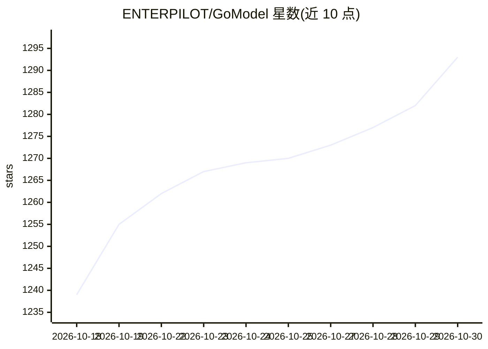

# ENTERPILOT/GoModel

⭐ 1,293 · Go · MIT · 推送 2026-10-29 · [GitHub](https://github.com/ENTERPILOT/GoModel) · [官网](https://gomodel.enterpilot.io/?utm_source=github_desc) · 组织维护

**Go 编写的 AI 网关：统一 OpenAI/Anthropic 兼容 API 接入多家模型**

用 Go 实现的自托管 AI 网关/控制平面，将 OpenAI、Anthropic、Gemini、Groq、xAI、Ollama、vLLM 等约 25 家提供方聚合为 OpenAI 兼容（/v1）与 Anthropic 兼容（/v1/messages）两种 API，官方 SDK 改 base URL 即可用。机制上提供缓存、成本追踪与预算、限流、虚拟模型负载均衡、会话固定、故障转移、guardrails、插件（含 .so 动态加载）、MCP 网关、Prometheus/OpenTelemetry 可观测性与 Web 仪表盘。通过 curl 安装脚本或 Docker 运行；另有商业版 GoModel Pro 提供提示压缩、智能路由、OIDC 单点登录。

## 筛选速览

| 维度 | 判定 | 备注 |
|---|---|---|
| AI 角色 | `ai-ecosystem` | LLM/agent 周边工具 |
| 许可风险 | `permissive` | MIT |
| 部署形态 | `self-host` | docker 或自建部署 |
| 模型依赖 | local-ok | 支持本地模型 |
| 硬件要求 | — | 无带数字的原话,不猜 |
| 安装摩擦 | `low` | 无编译、无系统依赖或容器化 |
| 成熟度 | — | 结构信号不足 |

## 能力要点

- 统一 OpenAI/Anthropic 兼容 API，覆盖 25+ 提供方（含 Ollama、vLLM、Bedrock）
- 缓存、预算硬限、虚拟模型负载均衡、故障转移与会话固定
- guardrails 与插件体系（内置/编译/启动时加载 .so）
- Prometheus 指标、OpenTelemetry 追踪、审计日志与仪表盘实时请求流

## 适用场景

- 统一管理多家 LLM 提供方的 API 调用与密钥轮换
- 按用户/团队/密钥控制预算、限流与模型访问权限
- 为 MCP 服务器聚合一个带鉴权的统一入口
- 通过仪表盘分析 token 用量与成本

## 场景标签

`模型网关` `LLM 可观测性` · 领域:Agent 开发

## 证据(README 行号)

> L15:  GoModel is the fastest and the most resource-efficient AI Gateway (the self-reproducible benchmarks). It's an alte
> L82: - OpenAI-compatible at `/v1`
> L83: - Anthropic-compatible at `/v1/messages`

## 星数曲线

2026-10-18 1,239 → 2026-10-30 1,293（+54）

---
*卡片 v1 · prompt 1.4 · 生成 2026-10-21 · 置信度 mid · 依据 README sha `f4cd52de5d8e` · [字段定义](../../DATASET.md)*
