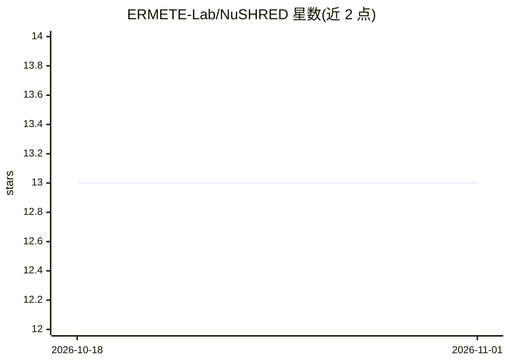

# ERMETE-Lab/NuSHRED

⭐ 13 · Jupyter Notebook · MIT · 推送 2026-10-08 · [GitHub](https://github.com/ERMETE-Lab/NuSHRED) · [官网](https://ermete-lab.github.io/NuSHRED/) · 组织维护

**核反应堆系统状态估计的 SHRED 代码集，配套五篇论文**

汇集 SHRED（Shallow REcurrent Decoder）方法在核反应堆系统上的应用代码，作为五篇论文（P1–P5）的补充材料，覆盖 MSFR、DYNASTY 实验装置、TRIGA Mark II、LRA 中子学与反应-扩散-对流等案例。核心机制是从少量传感器测量序列重建全流场状态（降阶模型）。仿真数据集托管于 Zenodo，提供下载脚本；基础安装用 uv sync 或 pip 可编辑安装，P1 需额外安装不在 PyPI 的 pyforce，P5 仅在自行重新生成数据时需另建 conda 环境安装 FEniCSx。每篇论文目录附 notebook 与 README。

## 筛选速览

| 维度 | 判定 | 备注 |
|---|---|---|
| AI 角色 | `ai-native` | 本体是模型或模型工具 |
| 许可风险 | `permissive` | MIT |
| 部署形态 | `library` | 以包/库形式分发 |
| 模型依赖 | — | README 未给出锁定关系 |
| 硬件要求 | — | 无带数字的原话,不猜 |
| 安装摩擦 | `medium` | 含编译或系统依赖之一 |
| 成熟度 | — | 结构信号不足 |

## 能力要点

- SHRED 方法在核反应堆系统（MSFR/TRIGA/DYNASTY 等）的状态重建与预测代码
- Zenodo 托管压缩仿真数据集，脚本一键下载
- uv sync 基础安装，P1/P5 提供额外依赖通道
- 含 Kolmogorov 2D 流动单参数与多参数教程

## 适用场景

- 复现论文中的反应堆状态估计实验
- 基于部分传感器测量重建核反应堆全流场状态
- 学习 SHRED 降阶建模方法在多物理场问题上的应用

## 场景标签

`科研工具` · 领域:学习与行业

## 证据(README 行号)

> L8: This repository collects the codes regarding the application of the **Shallow REcurrent Decoder** (SHRED) method to 
> L69: 📁 **shred/** → Modules for the implementation of the SHRED network from **github.com/Jan-Williams/pyshred** and **g

## 星数曲线

2026-10-18 13 → 2026-11-01 13（+0）

---
*卡片 v1 · prompt 1.4 · 生成 2026-11-01 · 置信度 high · 依据 README sha `3afa44529192` · [字段定义](../../DATASET.md)*
