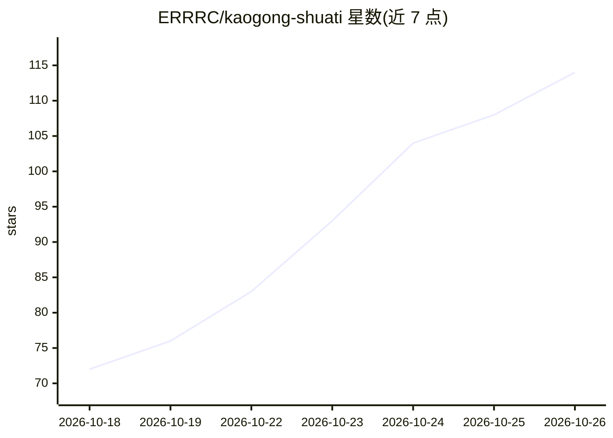

# ERRRC/kaogong-shuati

⭐ 114 · JavaScript · MIT · 推送 2026-09-24 · [GitHub](https://github.com/ERRRC/kaogong-shuati) · 个人维护 · 中文 README

**考公刷题应用：本地题库刷题+错题本+AI解析批改**

面向公务员/事业单位备考者的刷题全栈应用：零依赖 Node.js 后端 + 本地 SQLite 题库，支持行测六大模块树、申论五题型树刷题，做题记录落库并跨设备同步，提供错题本、收藏与统计。内置五个 OpenAI 兼容协议的 AI 智能体：行测方法论解析、申论采分制批改、图形推理识图转写（多模态视觉模型）、学习进度顾问、题目导入解析，各自独立配置 base_url/api_key/model，支持 DeepSeek/通义/GLM/Ollama 等网关。同一代码运行于浏览器与 Android（Capacitor）。题库数据获粉笔等来源方授权，仅供个人学习。

## 筛选速览

| 维度 | 判定 | 备注 |
|---|---|---|
| AI 角色 | `ai-enhanced` | 去掉 AI 部分产品仍成立 |
| 许可风险 | `permissive` | MIT |
| 部署形态 | `None` |  |
| 模型依赖 | local-ok | 支持本地模型 |
| 硬件要求 | — | 无带数字的原话,不猜 |
| 安装摩擦 | `low` | 无编译、无系统依赖或容器化 |
| 成熟度 | — | 结构信号不足 |

## 能力要点

- 五个 OpenAI 兼容 AI 智能体，独立配置可热切换
- 本地 SQLite 题库 + 零依赖 Node.js 后端，支持离线刷题
- 多模态识图转写：图形推理/图表/手写图片逐字转写
- 自定义题库导入（文本/PDF/Excel/OCR）并 AI 拆分为结构化题目

## 适用场景

- 备考国考/省考/事业编时按知识点树刷行测和申论
- 让 AI 按采分制批改申论主观题并讲解行测解题方法
- 跨设备同步做题记录、整理错题本和查看薄弱环节

## 场景标签

`OCR` `文档解析` · 领域:知识与检索

## 证据(README 行号)

> L1: # 考公刷题（行测/申论/事业编）—— Web + Android + AI 解析
> L7: 零依赖 Node.js 后端 + 本地 SQLite 题库的考公刷题全栈应用：模块树刷题、错题本、学习统计，内置可插拔的 AI 智能体（行测方法论解析、申论要点批改、图形推理识图转写、学习建议、题目导入解析）。同一套代码同时服务浏览
> L22: **AI 能力**（五个智能体，OpenAI 兼容协议，各自独立 base_url / api_key / model，改完即生效，提示词带版本历史可回滚）

## 星数曲线

2026-10-18 72 → 2026-10-26 114（+42）

---
*卡片 v1 · prompt 1.4 · 生成 2026-10-23 · 置信度 high · 依据 README sha `4c2003463d79` · [字段定义](../../DATASET.md)*
