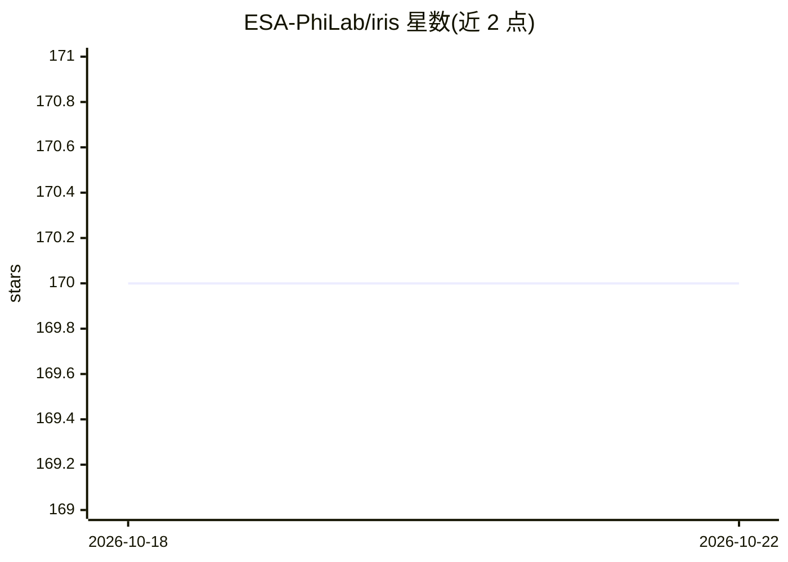

# ESA-PhiLab/iris

⭐ 170 · JavaScript · GPL-3.0 · 推送 2026-10-09 · [GitHub](https://github.com/ESA-PhiLab/iris) · 组织维护

**卫星图像人工标注工具：AI 辅助加速地学训练集制作**

ESA PhiLab 维护的半自动图像分割标注工具，面向地球观测机器学习训练集制作。本体是可本地运行的 Flask 应用，支持多光谱影像的多视图可配置显示、多用户协作与结果合并；人工分割过程中由梯度提升决策树模型提供辅助建议。安装方式为源码 setup.py 或 pip -e，另提供 Docker 部署与 GitHub Codespaces 运行路径，平台覆盖 Linux/Windows/macOS，推荐配合键盘与滚轮鼠标使用。

## 筛选速览

| 维度 | 判定 | 备注 |
|---|---|---|
| AI 角色 | `ai-enhanced` | 去掉 AI 部分产品仍成立 |
| 许可风险 | `viral` | GPL-3.0 |
| 部署形态 | `self-host` | docker 或自建部署 |
| 模型依赖 | — | README 未给出锁定关系 |
| 硬件要求 | — | 无带数字的原话,不猜 |
| 安装摩擦 | `low` | 无编译、无系统依赖或容器化 |
| 成熟度 | — | 结构信号不足 |

## 能力要点

- 梯度提升决策树辅助人工图像分割
- 多光谱影像的多视图可配置显示
- 多用户协作标注并合并结果
- 提供 Docker 部署与 Codespaces 运行方式

## 适用场景

- 为地球观测模型制作分割训练数据集
- 团队多人协作标注同一数据集并合并结果
- 查看并标注多光谱卫星影像

## 场景标签

`目标检测` · 领域:感知与多模态

## 证据(README 行号)

> L4: Tool for manual image segmentation of satellite imagery (or images in general). It was designed to accelerate the cr
> L5: * Support by AI (gradient boosted decision tree) when doing image segmentation

## 星数曲线

2026-10-18 170 → 2026-10-22 170（+0）

---
*卡片 v1 · prompt 1.4 · 生成 2026-10-22 · 置信度 high · 依据 README sha `53fac1054be2` · [字段定义](../../DATASET.md)*
