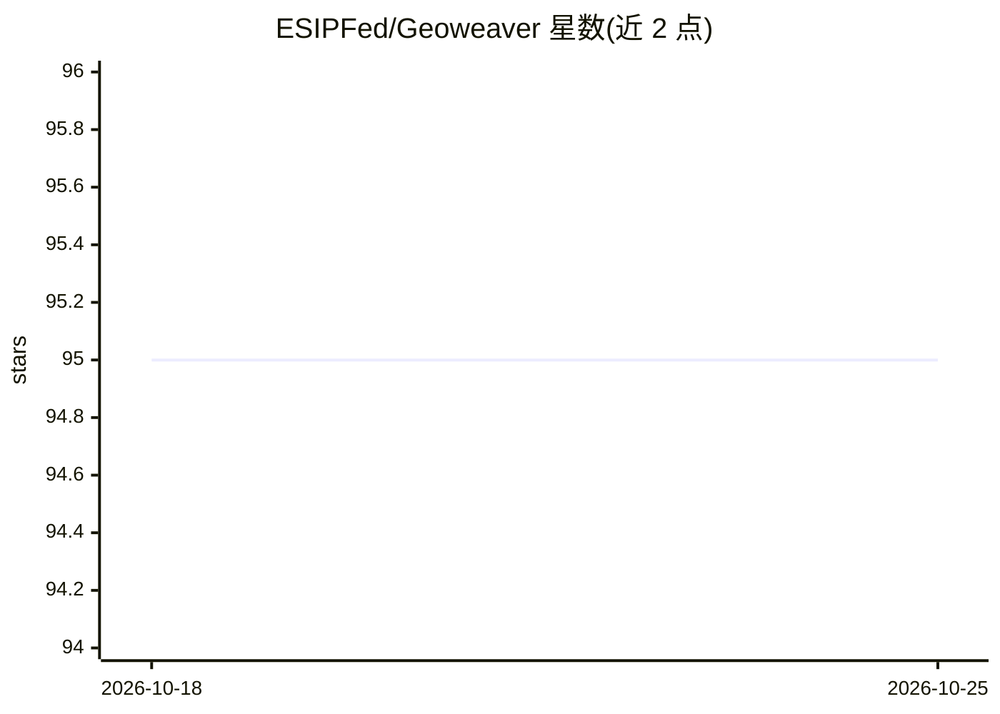

# ESIPFed/Geoweaver

⭐ 95 · JavaScript · MIT · 推送 2026-10-19 · [GitHub](https://github.com/ESIPFed/Geoweaver) · [官网](https://geoweaver.dev) · 组织维护

**科研数据流水线的工作流编排与管理工具，面向地学等研究场景**

浏览器中运行的软件，用于编写与执行全栈数据处理工作流：支持注册 SSH 远程主机并分发执行过程，过程类型覆盖 Python、Bash、R 等；提供可视化工作流构建、顺序与并行执行、Jupyter Notebook 导入导出与版本跟踪、执行历史记录与日志、数据管道依赖可视化。可用 pip 安装 pygeoweaver 启动、运行 jar 包或 Docker 运行；2.2+ 版本需要 Java 17 及以上，Docker 为可选方式。由 ESIP 联盟维护，应用于地球科学研究中的 ML 工作流管理。

## 筛选速览

| 维度 | 判定 | 备注 |
|---|---|---|
| AI 角色 | `ai-ecosystem` | LLM/agent 周边工具 |
| 许可风险 | `permissive` | MIT |
| 部署形态 | `desktop` | 安装包/桌面程序 |
| 模型依赖 | — | README 未给出锁定关系 |
| 硬件要求 | — | 无带数字的原话,不猜 |
| 安装摩擦 | `low` | 无编译、无系统依赖或容器化 |
| 成熟度 | — | 结构信号不足 |

## 能力要点

- 可视化工作流编排，支持并行/串行与跨资源分发执行
- SSH 主机注册与远程过程执行管理
- Jupyter Notebook 导入导出与过程代码版本控制
- 执行历史、日志记录与数据管道依赖可视化

## 适用场景

- 把地学科研中的数据处理与机器学习步骤组织为可复用的工作流
- 通过 SSH 在远程服务器上执行和监控 Python/Bash/R 过程
- 长期研究项目中记录执行历史与过程版本，追踪研究进展

## 场景标签

`工作流自动化` `科研工具` · 领域:效率与自动化

## 证据(README 行号)

> L32: Geoweaver is an in-browser software allowing users to easily compose and execute full-stack data processing workflo
> L214: Sun, Z. et al., "Geoweaver: Advanced cyberinfrastructure for managing hybrid geoscientific AI workflows." ISPRS In

## 星数曲线

2026-10-18 95 → 2026-10-25 95（+0）

---
*卡片 v1 · prompt 1.4 · 生成 2026-10-23 · 置信度 high · 依据 README sha `150fd1bda6cd` · [字段定义](../../DATASET.md)*
